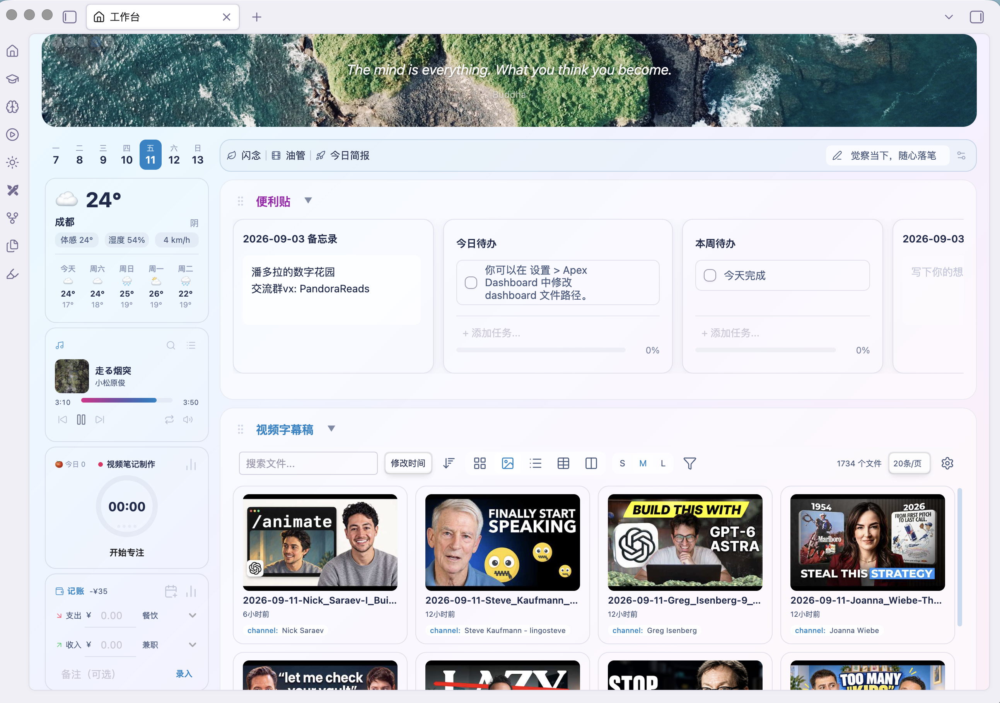
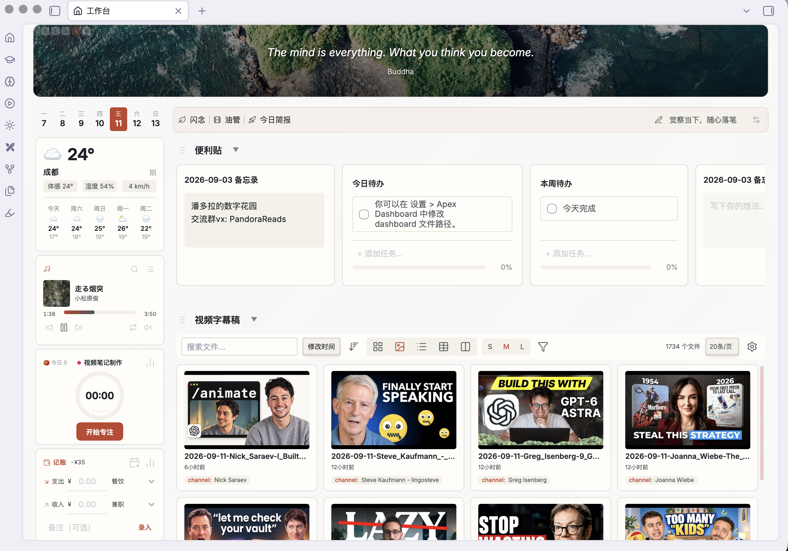
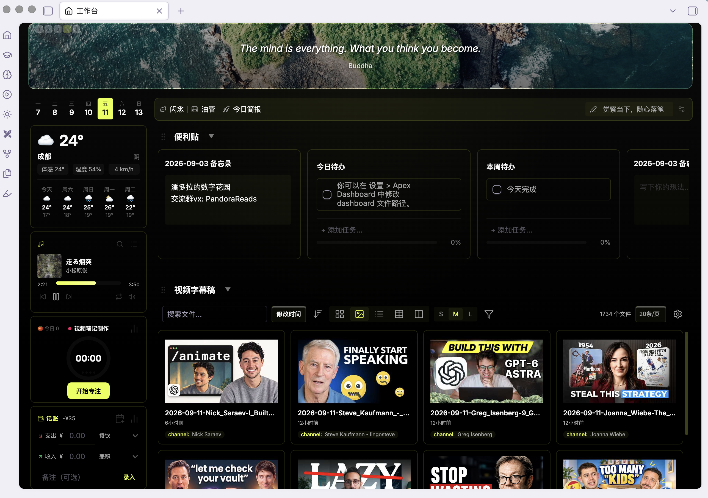

# Apex Dashboard

> Pare de ficar alternando entre notas do Obsidian. Uma página só. Tudo o que você precisa. Anote seus pensamentos com memos, domine seus todos, acompanhe seus projetos — e deixe tudo com uma aparência incrível.

## Captura de tela

**Idioma / Language**: [English](README_EN.md) | [简体中文](README.md) | [繁體中文](README_zh-TW.md) | [日本語](README_ja.md) | [한국어](README_ko.md) | [Español](README_es.md) | [Français](README_fr.md) | [Deutsch](README_de.md) | **Português (Brasil)** | [Русский](README_ru.md) | [ไทย](README_th.md)

## Funcionalidades

### 🗒️ Memo
Capture pensamentos instantaneamente com um bloco de notas integrado. Cada cartão de memo tem uma área de texto editável — anote ideias, notas de reuniões ou reflexões do dia sem sair do seu dashboard. Suporta `[[wikilinks]]` que são renderizados como links clicáveis.

### ✅ Todo
Gerencie tarefas com checklists interativos. Adicione, reordene, arraste e solte e marque tarefas como concluídas. Uma barra de progresso mostra o percentual de conclusão de relance. Itens de todo também suportam `[[wikilinks]]` para referências cruzadas entre notas.

### 📁 Projects
Organize os documentos do seu vault em cartões de projeto. Cada cartão links para notas relacionadas, exibe uma imagem de capa (suporta tanto imagens locais do vault quanto URLs da web) e oferece busca inline de documentos para adicionar novos arquivos rapidamente. Gerencia vários tipos de arquivo, incluindo notas Markdown, PDFs, imagens, áudio e vídeo.

### 📝 Notes
Uma seção compacta, em estilo de lista, para organizar documentos de referência e arquivos de acesso rápido. Exibe até 5 cartões por linha, sem imagens de capa, para densidade máxima.

### 📅 Calendar
Um calendário nativo em grade mensal de todas as tarefas com data em todo o seu vault (sem necessidade de dataview ou plugin externo). Cada célula do dia lista suas tarefas; clique em um dia para ver sua agenda. Abra um calendário em tela cheia com navegação por mês e alternância inline. Eventos de múltiplos dias com `[start::]` / `[end::]` se estendem por vários dias. A visualização ampliada do widget da barra lateral também está disponível como uma **seção Calendar** incorporada ao painel — grade mensal completa (com barras de múltiplos dias), grade semanal com horários, filtro de tarefas e salto para hoje; clique em um número de dia para adicionar uma tarefa para aquele dia (gravada na nota diária ou na lista de todos do dashboard).

### 🔍 Dataview
Consulte seu vault com um motor DQL integrado — sem precisar do plugin Dataview. Adicione uma seção Dataview e escreva consultas como `TABLE file.name, rating FROM "Books" WHERE rating >= 4 SORT rating DESC`. Suporta saídas `TABLE`, `LIST`, `TASK`, `CALENDAR` e `HEATMAP` sobre pastas, tags e links (`FROM`), com cláusulas `WHERE`, `SORT`, `GROUP BY`, `FLATTEN` e `LIMIT`, ~40 funções integradas, todos os campos implícitos `file.*`, YAML frontmatter e campos inline (`[key:: value]`). O modal de configuração valida a sintaxe em tempo real e vem com consultas de exemplo de um clique. As caixas de seleção de `TASK` gravam de volta na nota de origem, `CALENDAR` plota uma grade mensal e `HEATMAP` plota uma grade de contribuições anual a partir de qualquer campo numérico. Os resultados são atualizados sob demanda pelo botão de atualizar da seção.

### 🌐 Web
Incorpore qualquer página da web diretamente em uma seção — cole uma URL e navegue como um painel de navegador dentro do quadro. O **modo automático** verifica previamente a política de enquadramento do site: sites que permitem enquadramento são incorporados como um iframe, enquanto os que recusam mudam para um webview de desktop (com login persistente próprio — recomendado para Keep, Todoist web e outros apps que exigem login); no celular, é exibido um cartão de fallback com um botão para abrir no navegador. Você também pode forçar o modo iframe/webview e escalar a página de 0,5–2× para web apps densos. Prefira sites https no celular; a incorporação é voltada para leitura — popups e downloads pertencem a um navegador de verdade.

### 📡 RSS
Assine blogs e feeds de notícias direto no quadro: adicione qualquer link RSS 2.0 / Atom e os artigos mais recentes de todos os feeds fluem juntos em uma única lista em ordem cronológica inversa (tags de origem, pontos de não lido), com filtro de não lidos e marcar tudo como lido. Clique em uma entrada para ler o artigo completo em um modal — feeds que trazem o texto completo são renderizados diretamente, e feeds apenas com resumo são baixados e têm o conteúdo principal extraído automaticamente. Cada entrada tem um botão de download que salva o artigo como uma nota do vault (nome com prefixo de data, frontmatter de origem, link original) na pasta configurada; entradas salvas levam direto à nota. O conteúdo dos feeds é armazenado em cache localmente por 30 minutos; o estado de lido e salvo persiste entre sessões.

### ⚡ Quick Actions
Fixe seus atalhos mais usados na barra lateral. Suporta dois tipos de ação: **File**, para abrir qualquer documento, e **Command**, atalhos para disparar qualquer comando do Obsidian. Inclui predefinições integradas para New Journal e New Note.

### 🌤️ Sidebar Widgets
A barra lateral esquerda traz 11 widgets que podem ser ativados/desativados independentemente e reordenados por arrastar:

- **Weather** — Clima em tempo real com temperatura atual, sensação térmica, umidade, velocidade do vento e uma previsão de 5 dias com temperaturas máximas/mínimas diárias. Powered by Open-Meteo (sem necessidade de chave de API). Busca de cidade com autocompletar por geocodificação para localização precisa
- **Lunar Almanac** — Data lunar tradicional chinesa, festivais e orientações diárias do que fazer ou não fazer
- **Pomodoro Timer** — Um temporizador de foco com seletor de atividade e ciclos de trabalho/pausa, além de um gráfico de rosca da divisão do dia; a visualização de estatísticas adiciona progresso da meta, pontuação de eficiência, gráficos de tendência, um heatmap de 12 semanas e uma linha do tempo de hoje
- **Reading Tracker** — Acompanhe suas sessões de leitura com um temporizador integrado. Adicione livros pela busca do Douban ou entrada manual, cronometre suas sessões de leitura e registre o progresso com números de página. Cada cartão de livro mostra imagem de capa, autor e barra de progresso de leitura
- **Countdown** — Contagens regressivas personalizáveis para qualquer datas-alvo, exibidas em dias ou horas restantes
- **Year Progress** — Quanto do ano atual já se passou
- **Calendar** — Grade de mês/semana agregando todas as tarefas com data do vault; clique em um dia para ver sua agenda e adicionar tarefas que são gravadas na nota diária daquele dia; eventos de múltiplos dias se estendem por vários dias
- **Habit Check-in** — Marcações diárias por hábito, com preenchimento retroativo de ontem, sequências (streaks) e estatísticas em heatmap
- **Expense Tracker** — Registro rápido de despesas/receitas (notas, datas retroativas, categorias personalizadas) com totais do dia e estatísticas por semana/mês/ano/tudo; o livro-caixa adiciona filtragem, edição inline e importação/exportação CSV
- **Photo Album** — Um porta-retratos digital para qualquer pasta do vault: rotação automática com pausa ao passar o mouse, anterior/próximo manual e um selo de índice, proporção de painel 1:1 ou 3:4, quatro transições (fade / push esquerda / push direita / zoom), intervalo de 3–60s, subpastas incluídas por padrão. A foto de abertura é semeada pelo horário (nunca é sempre a mesma), a próxima é pré-carregada, e adições/exclusões/renomeações no vault atualizam a lista no lugar sem perder sua posição
- **Music** — Busque e toque faixas gratuitas da NetEase Cloud Music na barra lateral: login opcional em conta NetEase nas configurações para faixas de membros autorizadas pela conta, cole um link de playlist para importar, controles de volume e repetição, playlist persistida com preenchimento preguiçoso de capas, e uma barra opcional de mini player flutuante que continua funcionando com o dashboard fechado (somente desktop)

A barra lateral também abriga a **faixa do calendário semanal** (7 dias compactos, com hoje destacado), **documentos recentes** e o botão de **voltar ao topo**; celulares têm a mesma barra de widgets, e os dados dos widgets são mesclados por união entre dispositivos.

### 🎨 Banner
Um banner personalizável com uma citação inspiradora e imagem de fundo opcional. Suporta tanto imagens locais do vault quanto URLs da web. Clique duas vezes para editar.

### 🔄 Drag & Drop
Arraste cartões entre seções para reorganizar seu espaço de trabalho. Arraste itens de tarefa dentro dos cartões de Todo para reordenar. Arraste links de documentos entre cartões de projeto/nota.

### 🧩 Custom Sections
**15 tipos de seção** para combinar como quiser — **Todo**, **Memo**, **Sticky Notes**, **Notes (cartões de projeto)**, **Notes (sem capa)**, **Dataview**, **Library**, **Folder**, **Images**, **Videos**, **Calendar**, **Weread**, **TickTick**, **Web** e **RSS** — cada um com seu próprio layout e comportamento, para que o quadro se adapte ao seu fluxo de trabalho.

### 🕐 Recent Documents
A barra lateral mostra os arquivos editados recentemente com timestamps relativos, para você voltar rapidamente ao seu trabalho mais recente.

## Temas

13 temas feitos à mão, cada um com identidade visual própria:

| Tema | Estilo |
|-------|-------|
| **Earth** | Sol toscano: pergaminho com lavagens quentes flutuantes de 32s, acento terracota e notas de oliveira |
| **Nordic** | Fiordo polar: auroras de geada sobre branco frio, acento verde-glacial azulado |
| **Pony** | Arco-íris de alta saturação inspirado em MLP: seis faixas aurora de doces sobre um céu noturno, um tom de pônei por seção |
| **Blossom** | Brilho de vidro rosado, seções transparentes |
| **Lilac** | Canteiro impressionista: lavagens lentas de 28s flutuando atrás de cartões marfim translúcidos, acento glicínia |
| **Island** (padrão) | Tons pastéis de Animal Crossing, verde floresta e azul oceano |
| **Tundra** | Cinza frio + aurora verde-abacate, cartões de vidro sage |
| **Matcha** | Estética de tigela de chá: lavagens de jardim de chá de 26s, cartões cerâmicos creme, acento matcha profundo com notas douradas |
| **Vermilion** | Minimalismo a tinta: fundo de papel de arroz e tinta sumi, deriva de lavagem de tinta de 40s, um único acento de selo vermelho-cinábrio |
| **Neon** | Quase-preto com acento magenta neon, idêntico nos modos claro e escuro |
| **Volt** | Quase-preto com acento ciano elétrico, idêntico nos modos claro e escuro |
| **Magma** | Quase-preto quente com acento laranja lava, idêntico nos modos claro e escuro |
| **Onyx** | Preto puro com acento limão, idêntico nos modos claro e escuro |

Todos os temas suportam tanto o modo claro quanto o escuro do Obsidian.

## Configurações

- **Dashboard file** — personalize o caminho do arquivo dos dados do seu dashboard
- **Style** — escolha entre 13 temas visuais
- **Language** — interface em inglês ou chinês
- **Recent documents count** — controle quantos arquivos recentes aparecem
- **Sidebar widgets** — Weather, Heatmap, Pomodoro, Reading, Countdown. Ative/desative e configure cada widget independentemente
- **Reading settings** — Ativar o rastreador de leitura, ligar/desligar o som de conclusão de sessão

## Instalação

### Pela loja de plugins da comunidade do Obsidian
1. Abra Settings > Community Plugins
2. Navegue e pesquise por "Apex Dashboard"
3. Clique em Install e depois em Enable

### Instalação manual
1. Baixe a versão mais recente em [GitHub Releases](https://github.com/pandorareads/apex-dashboard/releases)
2. Extraia para a pasta `.obsidian/plugins/apex-dashboard/` do seu vault
3. Abra Settings > Community Plugins e ative "Apex Dashboard"

## Uso

1. Abra o dashboard pelo ícone da ribbon (ícone de casa) ou pela paleta de comandos: `Apex Dashboard: Open dashboard`
2. Um arquivo `dashboard.md` é criado automaticamente na raiz do seu vault
3. Todas as alterações são salvas diretamente no arquivo — são os seus dados, em texto puro

> **Nota:** Excluir, renomear ou reordenar seções deve ser feito editando diretamente o arquivo `dashboard.md`. Qualquer alteração feita na nota surte efeito imediato na visualização do dashboard.

## ☕ Apoie o projeto (Buy Me a Coffee)

Se o Apex Dashboard torna seu fluxo de trabalho diário no Obsidian mais fluido, considere me pagar um café para apoiar o desenvolvimento contínuo.

  

## Novidades

### 3.8.8
- **Pipeline de arquivamento reforçado** — O arquivamento agora move o arquivo primeiro, verifica se a renomeação realmente aconteceu (com uma tentativa automática de retry) e só então grava o status: falhas silenciosas de movimentação em vaults sincronizados pelo iCloud não deixam mais uma nota meio arquivada presa na pasta do seu estágio (quatro ocorrências diagnosticadas). Uma movimentação que falha avisa e deixa o cartão no quadro, então mais um clique simplesmente repete a operação. Movimentos de arrastar entre estágios recebem a mesma proteção
- **Corrigida a reordenação por arrastar dos botões de skill nos cartões** — Causa raiz encontrada: mesmo com o arrastar nativo do cartão cancelado, o Chromium ainda libera o pointer capture do botão, matando os listeners locais de move/up do botão no instante em que o ponteiro sai dos 22px do botão — exatamente o que uma reordenação entre botões precisa. O gesto agora usa listeners de captura no nível do documento: troca ao vivo enquanto arrasta, ordem persistida ao soltar, e soltar sobre outro botão de skill não abre mais o modal dele por acidente
- **Botões de inicialização personalizados nos cartões da biblioteca de skills** — O menu do cartão ganha "Configure launch buttons…": escolha qualquer agente, rótulo, ícone, template de prompt e alternador de envio direto por skill. Botões personalizados são renderizados ao lado dos botões automáticos de origem — skills de pastas personalizadas (que não têm agente vinculado) finalmente ganham um ponto de entrada de envio, persistido junto com a seção
- **Layout do modal de configuração do pipeline** — O seletor de agente é um slot estreito fixo ao lado do campo de nome da skill (o texto longo da opção "coming soon" não estoura mais a linha), e os templates de prompt ganham um popup de texto completo — leia e edite tudo em uma única janela alta, com as edições voltando ao vivo
- **Espaço livre no rodapé do dashboard** — Ao rolar até o fim, a última seção e o botão de adicionar seção agora ficam acima de uma janela de chat de IA ancorada na parte inferior (60 → 200px no desktop); celulares e o layout imersivo mantêm seus próprios valores

### 3.8.7
- Local em Chinês Tradicional; o tema Blossom foi reconstruído como Barbie; correção de sobreposição de blocos no layout imersivo, renderização progressiva para seções de pipeline/PM e a remoção da barra lateral de seções no celular — veja as notas de versão 3.8.7

### 3.7.1
- **Seção RSS totalmente nova** — Assine qualquer feed RSS 2.0 / Atom e todas as fontes fluem juntas em um único fluxo em ordem cronológica inversa: pontos de não lido e filtro de não lidos, agrupamento por grupo ou por feed (lista de grupos gerenciável, criável direto na linha de um feed), e paginação com tamanho de página configurável (10/20/50/100). Clique em um artigo para lê-lo em um modal de leitura tematizado — feeds apenas com resumo têm a página completa baixada e o conteúdo principal extraído automaticamente, com degradação para o resumo e um botão de abrir no navegador. Cada artigo é salvo no vault como uma nota em um clique (o frontmatter espelha o template de inbox 「01 收集」, alimentando o pipeline PARA), e entradas salvas levam direto à nota. Importação de OPML (categorias viram grupos, com desduplicação de URLs) e exportação incluídas. Os feeds ficam em cache local por 30 minutos (fontes com falha tentam de novo em 5, concorrência educada de quatro vias), e feeds com problema são nomeados linha a linha com o motivo no modal de configuração. A retenção de marcadores de leitura é uma configuração (30/90/180/365 dias ou para sempre)
- **Correções de legibilidade no layout imersivo** — texto de entrada invisível em sessões claras do Obsidian (as regras de input do Obsidian tinham precedência sobre as do plugin) e títulos de colunas de kanban apagados em branco (um --db-bg ausente no bloco de variáveis do imersivo) foram corrigidos na raiz; pequenos botões de ícone em seções e modais não são mais repintados ou esmagados pelo estilo nativo de botões do Obsidian
- **Categorias predefinidas de despesas agora são editáveis** — as predefinidas agora se comportam exatamente como as personalizadas: exclusão, reordenação e mapeamento de grupo para todas; o histórico continua sendo exibido sob os rótulos removidos e nomes liberados podem ser readicionados; cada direção mantém ao menos uma categoria
- **Menu de clique direito do imersivo enxugado** — a entrada "organizar layout", de baixo desempenho, saiu; "remover cartão" permanece

### 3.7.0
- **Layout de espaço de trabalho imersivo totalmente novo** — todo espaço de trabalho pode alternar para um modo imersivo: um fundo de pôster em tela cheia com um relógio e uma barra de captura centralizada, e cada widget, memo e todo como um cartão de vidro livremente móvel — redimensione pelas bordas, alinhe com snapping inteligente. Crie um pelo botão + no seletor de espaços de trabalho

### 3.6.6
- **Temas salvos do Appearance Studio** — aparências personalizadas são salvas como temas com troca de um clique, além de uma entrada de comando rápido
- **Escudos contra sequestro de entrada** — snippets de terceiros não podem mais sequestrar os campos de entrada do dashboard com estilos globais
- **Correção de pulo silencioso no Music** — falhas ocasionais de reprodução da NetEase não pulam mais silenciosamente; elas notificam por causa primeiro
- **Teto de renderização elevado** — a renderização progressiva de grupos agora tem limite de 500 itens, então seções muito grandes mostram mais de si mesmas

### 3.6.5
- **Excluir cartões no lugar** — cartões de grade, galeria e kanban em seções de banco de dados/pastas mostram um botão de lixeira no canto ao passar o mouse (sempre visível no celular) — chega de cavar em menus
- **Nova nota a partir de múltiplos templates** — a configuração de "template de nova nota" agora aceita múltiplos templates; escolha um a cada clique no "+" da barra de ferramentas, e a nota já vem preenchida com os filtros da seção. Configurações de template único migram automaticamente
- **Controle de colunas na visualização em tabela** — um botão de olho na barra de ferramentas lista todos os campos de propriedade: esconda o que não precisa e arraste para reordenar, memorizado por seção; configurações de colunas antigas migram automaticamente
- **Proteção de renderização para vaults grandes** — visualizações agrupadas e kanban renderizam progressivamente (50 por grupo/coluna com um botão "mostrar mais") e limitam a 2000 itens com um aviso — seções com milhares de arquivos não travam mais o dashboard
- **Aniversários lunares** — datas de aniversário podem ser lunares (armazenadas como datas solares sem perda); lembretes são mapeados para aniversários lunares
- **Pontos focais de capa e banner** — as capas de projetos e os fundos do banner permitem arrastar para escolher a posição focal, memorizada por imagem rotativa
- **Horários e destinos de tarefas no calendário** — Tarefas suportam campos de data de início/prazo/agendada com horários opcionais ao longo dos dias (`[start::]`/`[due::]`/`[scheduled::]`); um modo de destino "uma nota por tarefa" cria/anexa uma nota datada automaticamente
- **Seções sem capa fundidas em Notes** — o tipo "notas sem capa" se funde em "Notes" com uma alternância "mostrar capas" por seção; configurações antigas migram automaticamente
- **Filtros de propriedade para seções de pastas** — seções de pastas ganham o mesmo editor de filtro de propriedade das seções de banco de dados (igual/contém/diferente)

### 3.6.3
- **Agrupamento para visualizações de biblioteca/pastas** — visualizações em grade, galeria, lista e tabela ganham um botão "Group" na barra de ferramentas: sem agrupamento, por pasta (pastas de primeiro nível sob as pastas de varredura) ou por qualquer propriedade de frontmatter; a escolha persiste por seção no arquivo do quadro; a visualização kanban mantém seu agrupamento existente no diálogo de configuração
- **Expandir/recolher todos os grupos** — com o agrupamento ativo, seções de biblioteca/pastas ganham um botão na barra de ferramentas que expande ou recolhe todos os grupos em um clique; o ícone e o tooltip acompanham o estado atual
- **Área de widgets redimensionável** — layout lateral: arraste a borda da barra lateral para redimensionar a largura (180–420px, memorizado); layout empilhado: arraste a faixa de widgets para definir a altura (240–560px); os níveis de altura dos widgets de hábitos e leitura (total / dois terços / metade / um terço) podem ser escolhidos nas configurações
- **Correção de reprodução no widget de música** — falhas intermitentes de entitlement -110 da NetEase agora recebem retries espaçados antes de desistir, então faixas com direito param de ser puladas; faixas realmente não reproduzíveis se identificam e informam o motivo (assinatura, compra ou direitos regionais) em um aviso antes de avançar — chega de pulos silenciosos
- **Arquivamento em um clique para a nota diária de hoje** — uma nova configuração "Destino do arquivamento": o arquivo fixo (como antes) ou a nota diária de hoje (criada automaticamente a partir do template do plugin nativo Daily notes quando não existe); o arquivamento aborta com um aviso se a nota diária não puder ser resolvida
- **Template personalizado para salvar memo** — salvar um cartão de memo/sticky como nota agora suporta um template personalizado
- **Correção de desempenho de atualização** — mudanças no vault reconstruem apenas as seções cujo escopo de varredura cobre o caminho alterado: editar notas em outros lugares, descartes de RSS e rotatividade de imagens não piscam mais todas as seções de biblioteca/pastas; uma seção cujos resultados de consulta não mudaram pula a reconstrução por completo (edições fora do escopo: 3 seções por passagem → 0)
- **Posição de rolagem preservada em todos os lugares** — re-renderizações completas capturam o estado de rolagem da página inteira (a rolagem horizontal do deck de widgets empilhados, a região de rolagem, decks de cartões, listas de tarefas, listas internas de widgets) e a reproduzem exatamente depois; chaves baseadas em âncora sobrevivem a reordenações de seções/widgets — onde você estava trabalhando é onde você fica, chega de pular de volta ao topo

### 3.6.2
- **Esquemas de cores e predefinições do Theme Studio** — cada área de cor ganha um seletor de esquema (seguir tema / claro / escuro / personalizado, a receita de primeiro plano do fundo de widgets) com predefinições por campo para escolha rápida
- **Nova nota em seções Notes** — seções de notas com e sem capa ganham um botão de "nova nota" por cartão, além de configurações de seção para o template da nova nota e a pasta de salvamento (raiz do vault quando não definida)
- **Cartões de memo renderizam markdown** — cartões de memo e sticky renderizam o corpo pelo renderer do Obsidian (adaptação que preserva linhas, memos existentes mantêm a aparência)
- **Correção** — o template de nova nota da seção de pastas era silenciosamente descartado ao salvar as configurações; o frontmatter do template agora é mesclado sob as props de filtro com as linhas originais preservadas

### 3.6.1
- **Barras de ferramentas das seções recolhem-se em botões dropdown** — o seletor de visualização e os controles de tamanho de cartão (P/M/G) nas seções de biblioteca/pastas/imagens/vídeos recolhem-se cada um em um único botão que mostra a escolha atual; clicar abre o menu nativo para escolher — uma barra de ferramentas bem mais silenciosa
- **Escopo de exibição de imagens/vídeos** — uma nova configuração "Escopo de exibição": multisseleção de pastas do vault (com seletor); quando definido, apenas arquivos sob elas aparecem (exclusões ainda se aplicam dentro do escopo); vazio = vault inteiro
- **Template de nova nota por seção** — os diálogos de configuração de pasta/biblioteca ganham um "Template de nova nota": notas criadas pelo "+" da barra de ferramentas partem do corpo do template (com {{title}} e {{date:…}} substituídos) mantendo as props de filtro da seção pré-preenchidas; um template ausente degrada para uma nota vazia
- **Destino de tarefas do calendário** — as configurações do calendário ganham um "Destino de tarefas": manter a cadeia padrão (nota diária do dia → lista de todos do dashboard), ou fixar um arquivo específico (inserir no topo/base) ou uma pasta (uma nota AAAA-MM-DD por dia, criada automaticamente)
- **Botões de ação rápida viram vidro em todos os temas** — os preenchimentos e bordas dos botões em Earth/Nordic/Island/Tundra/Matcha/Lilac/Vermilion/Aurora agora são vidro translúcido tingido pelo acento, igualando os cinco temas que já tinham isso — todos os doze parecem os mesmos
- **Alfa do Theme Studio + fundo da página corrigidos** — cada linha de cor ganha um slider de opacidade (0–100%); o fundo de página personalizado agora realmente se aplica (gradientes de temas de lavagem também são substituídos) e alfa 0 revela o fundo do Obsidian
- **Painel interno fosco em cartões com imagem de fundo** — com uma imagem de fundo definida, um painel distinto de vidro fosco flutua sobre a foto (desfoque real + preenchimento do cartão do tema + borda superior iluminada); o widget de pomodoro entra no clube das imagens de fundo (engrenagem no grupo da linha superior)
- **Muitos refinamentos** — o marcador do banner recolhido se telescopia até o passar do mouse; o botão da paleta de ações rápidas foi removido (imagens + cores de primeiro plano o substituem); botões do cabeçalho de hábitos sempre visíveis; a cor de primeiro plano personalizada agora inverte também o texto herdado (rótulos de ações rápidas corrigidos); corrigido o widget lunar perdendo a reordenação por arrastar após atualização assíncrona (delegação de eventos); corrigida a quebra do arrastar de par de larguras no Windows (valor de parceiro obsoleto com wrap-around + arredondamento subpixel + eventos engolidos pelo webview, as três raízes)

### 3.6.0
- **Layout empilhado totalmente novo** — Settings → General → Layout ganha seleção ilustrada: lado a lado (clássico) ou empilhado — widgets se organizam em um deck de cartões proporcional à altura (total / dois terços / metade / um terço) sob o banner, a barra de notas rápidas continua fixa, widgets e seções rolam como uma única página, fixar/recolher inalterados; celulares não são afetados
- **Fundos de widgets e esquemas de primeiro plano** — Aniversário, contagem regressiva, progresso do ano, música, hábitos e ações rápidas suportam fundos personalizados (o seletor de imagens lista apenas imagens, URLs de imagens da rede são bem-vindas) com sliders de opacidade / escurecimento / desfoque e cores de primeiro plano claras / escuras / seletor personalizado; a engrenagem no canto do cartão muda tudo sem sair do dashboard
- **Novo widget de Aniversário** — Tempo decorrido desde uma data histórica (anos-meses-dias / total de dias / dias+horas de precisão), lembrete opcional todo ano no mesmo dia, seletor de datas nativo
- **Widget de álbum multi-instância** — Adicione quantos álbuns quiser, cada um com sua própria pasta e tamanho de cartão
- **Correção: arrastar de par de larguras quebrado no Windows** — As três causas raiz corrigidas (valor de parceiro obsoleto deslocando linhas, arredondamento subpixel, páginas incorporadas engolindo eventos de mouse por uma proteção de pointer-capture)

### 2.5.3
- **Reordenação de categorias e grupos primários** — O diálogo "Gerenciar categorias" agora permite ordenar arrastando (predefinidas incluídas; o dropdown de entrada e os filtros do livro-caixa acompanham; botões para cima/baixo cobrem toque). Uma nova camada de grupo primário: crie grupos, atribua categorias, e o livro-caixa ganha uma coluna "Primário" além de um filtro de grupo (com um balde "Sem grupo"); a rosca de estatísticas e o ranking alternam entre agregação por categoria e por grupo. O agrupamento é armazenado separadamente, então reagrupar reorganiza todo o histórico sem tocar em nenhum registro
- **Histórico por semana e mês** — O intervalo "Histórico" das estatísticas ganha um sub-alternador semana/mês/ano com paginação ‹ ›: veja qualquer semana passada (rotulada com seu intervalo de datas), mês ou ano; os deltas de KPI comparam com o período anterior equivalente, e as tendências plotam por dia em semanas/meses e por mês em anos; a paginação para no período atual e no ano mais antigo com dados
- **Correção: chips de delta do KPI espremendo o número** — Cartões de estatísticas de despesas e pomodoro agora dão ao valor sua própria linha centralizada com o chip de período sobre período quebrado e centralizado embaixo — chega de espremer ou estourar o cartão

### 2.5.2
- **Autocura da reprodução de música** — Uma falha transitória não exibe mais "erro de reprodução, pulando para a próxima faixa" e perde a música permanentemente: ela tenta de novo silenciosamente a mesma faixa uma vez com um link assinado novo (quedas no meio do fluxo retomam na mesma posição, e links expirados durante uma pausa longa são trocados por novos); só se a repetição falhar ela segue adiante discretamente. Três avisos acionáveis permanecem: clicar em uma faixa VIP, um login expirado e a parada por disjuntor após falhas repetidas
- **Dropdown de fonte da citação do banner** — Chega de digitar nomes de fontes na mão: escolha em um dropdown de oito fontes chinesas (KaiTi, Songti, Fangsong, Lishu, Xingkai, Yuanti, Heiti, LXGW WenKai) e oito ocidentais (Georgia, Times, Palatino, Baskerville, Garamond, Didot, Helvetica, Courier). Cada entrada armazena uma pilha de fontes multiplataforma, então uma configuração renderiza igual em macOS, Windows e iPad; nomes digitados manualmente antes continuam selecionáveis no dropdown

### 2.5.1
- **Login em conta NetEase** — No desktop, abra a página oficial da NetEase a partir de Settings → Widgets → Music (login por celular ou QR) e toque com os direitos da sua conta — faixas de assinatura e compradas tocam por completo. As credenciais vão direto para a NetEase; a sessão vive em uma partição Electron local do dispositivo, nunca nos dados do plugin ou na sincronização do vault, e é limpa ao sair. O uso anônimo permanece igual
- **Mover cartões entre seções** — Arraste a barra de título de um cartão para movê-lo entre Todo, Memo e Sticky; tarefas e estados de conclusão sobrevivem às conversões Todo↔Memo e links de notas viajam junto; cartões de nota (com ou sem capa) também podem entrar nas três seções
- **Fonte da citação do banner** — Ao lado do seletor de cor da citação, um nome de fonte personalizado (ex.: KaiTi, Georgia) agora estiliza a citação e a linha do autor; o reset volta ao padrão do tema
- **Seções de biblioteca/pastas mais altas no celular** — Altura de linha 50vh→60vh mais uma barra de ferramentas mais enxuta (contagem/tamanho de página recolhidos): a visualização em grade mostra 3-4 cartões em celulares convencionais. Tablets e desktop inalterados
- **Correção: cartões arrastados ocasionalmente sumindo** — Reforçada a resolução de alvo de soltar e a ordem de gravação; cartões não desaparecem mais após um arrasto entre seções seguido de recarga

### 2.5.0
- **Widget Photo Album** — Aponte para uma pasta do vault e ele rotaciona pelas imagens como um porta-retratos digital: passe o mouse para pausar, anterior/próximo manual (que reativa o temporizador automático para nunca pular duas vezes), selo de índice, proporção de painel 1:1 ou 3:4, quatro transições (fade / push esquerda / push direita / zoom) dirigidas por um pingue-pongue de duas camadas, intervalo de 3–60s, subpastas incluídas por padrão. A foto de abertura é semeada pelo horário, a próxima é pré-carregada, e adições/exclusões/renomeações no vault atualizam a lista no lugar — uma foto atual que sobrevive continua tocando sem interrupção
- **Widget de música** — Busque e toque faixas gratuitas da NetEase Cloud Music na barra lateral: login opcional em conta NetEase nas configurações para faixas de membros autorizadas pela conta, importação de playlist por link, controles de volume e repetição, playlist persistida com preenchimento preguiçoso de capas, e uma barra opcional de mini player flutuante que sobrevive ao fechamento do dashboard (somente desktop)
- **Corrigido: controles dentro dos widgets acionavam o arrastar para reordenar** — Os widgets da barra lateral eram arrastáveis como um todo, então pressionar e arrastar um slider de volume, entrada, select ou botão era lido como gesto de reordenação (mais visível no knob de volume do painel de música). O arrastar agora é armado por gesto: pressionar um controle de formulário ou botão o desliga, pressionar a superfície simples do widget o liga — consistente em todos os widgets
- **Modal de anúncio** — Retitulado para "2 seções + 2 widgets" e agora apresenta os widgets de álbum e música junto com as seções de calendário e web

### 2.4.1
- **Tema Vermilion (antes Mono, renascido)** — O par preto/branco puro fúnebre foi curado: fundo quente de papel de arroz e tinta sumi com subtom azulado substituem os cinzas neutros, uma deriva de lavagem de tinta de 40s (a mais lenta de todos os temas) respira atrás dos cartões, e um único acento de vermelho-cinábrio de selo (links, caixas de seleção, foco, progresso) pousa como o carimbo em um pergaminho — o par preto/branco fica, o clima passa de velório para escritório
- **Tema renomeado** — Mono agora é Vermilion; instalações existentes mantêm sua seleção intacta
- **Ordem dos temas** — Blossom e Lilac movidos para depois de Pony, Vermilion depois de Matcha; dropdown, comando de ciclagem e a tabela do README estão sincronizados

### 2.4.0
- **Cinco temas renascidos** — Pony, Lilac, Earth, Nordic e Matcha todos ganharam fundos de lavagem flutuante lenta (26–32s, respirando em vez de se exibindo; fixado automaticamente no celular e sob movimento reduzido) mais seguro de modais opacos (chega de diálogos branco-sobre-branco em bases claras do Obsidian)
- **Pony (antes Aurora)** — Arco-íris MLP de alta saturação: seis faixas aurora de doces ciclando sobre um céu noturno, e cada seção veste seu próprio tom de pônei no título (memo=rosa Pinkie, todo=âmbar Applejack, notes=amanteigado Fluttershy, projects=azul Rainbow Dash, library=violeta Twilight…), com brilhos de hover nos cartões a condizer e um gradiente de progresso açucarado
- **Lilac** — Canteiro impressionista: aquarelas de glicínia/rosa/marfim flutuando por 28s atrás de cartões marfim translúcidos, com um acento de glicínia que finalmente se destaca do fundo
- **Earth** — Sol toscano: luz de mel/terracota/oliveira rastejando pelo pergaminho por 32s, seções de vidro quente sobre cartões creme sólidos, acento terracota
- **Nordic** — Fiordo polar: aurora azul-gelo/ciano-gelo/índigo/menta sobre branco frio, acento verde-glacial azulado — as placas planas de ardósia se foram
- **Matcha** — Estética de tigela de chá: lavagens de jardim de chá atrás de cartões cerâmicos creme translúcidos, acento matcha profundo claramente separado do fundo sage (antes eram quase idênticos), notas douradas por toda parte
- **Correção global** — Quatro estados ativos roxos codificados (cartões de adicionar seção, opções do weread…) agora derivam do acento de cada tema; todos os temas se beneficiam

### 2.3.0
- **Seção Calendar** — A visualização ampliada do calendário da barra lateral incorporada direto no quadro: grade mensal completa (eventos de múltiplos dias como barras contínuas) e grade semanal com horários, alternância mês/semana, filtro de tarefas e um salto para Hoje. Passe o mouse sobre uma data para espiar a lista completa de tarefas do dia; clique em um número de data para adicionar uma tarefa para aquele dia (gravada na nota diária ou na lista de todos do dashboard). As tarefas agregam o vault inteiro e a grade se atualiza no lugar conforme as notas mudam.
- **Seção de incorporação Web** — Fixe qualquer página da web no quadro: insira uma URL e ela é incorporada. O modo automático verifica previamente a política de enquadramento do site — sites enquadráveis carregam como iframe, os que recusam mudam para um webview de desktop (login persistente; ótimo para Google Keep ou TickTick web), e no celular aparece um cartão de fallback com um botão para abrir no navegador. Bloqueio manual de iframe/webview e zoom de 0,5–2x são suportados.
- **Correção: o diálogo de confirmação de exclusão escurecia a tela a cada Enter** — O diálogo nunca reivindicava foco nem teclas, então cada Enter reacionava o botão de excluir ainda focado por baixo e empilhava mais uma camada meio-preta. Agora ele foca o botão padrão seguro ao abrir, com semântica clara de Enter/Escape — chega de empilhar.

### 2.2.0
- **Visualização em galeria** — Seções de biblioteca e pastas ganham uma visualização em galeria: os cartões renderizam imagens de capa (dos campos `封面`/`cover` ou qualquer valor em formato de imagem) com uma alternância de tamanho P/M/G na barra de ferramentas, persistida por seção; o nível pequeno quadra capas 1:1, médio/grande mantêm 16:10
- **Memória de tamanho de mídia** — As seções de imagens/vídeos lembram sua escolha de tamanho de miniatura entre recargas e reinicializações
- **Propriedades fixadas nos cartões** — Escolha exatamente quais campos de frontmatter aparecem nos cartões (chaves comuns fixadas primeiro, chaves varridas do vault, além de adições personalizadas), complementando o fallback de contagem máxima
- **Config de pastas: busca de tags** — Uma caixa de busca na seção de filtro de tags para localização rápida quando o vault tem muitas tags
- **Correções** — Botão de fechar duplicado no popover de nota no Obsidian 1.13+; posição de inserção de tarefas do calendário, renderização de número do dia, seletor de caminhos e reforço do mapeamento de símbolos do clima

### 2.1.2
- **Island se torna o tema padrão** — Novas instalações começam na paleta pastel de Animal Crossing; duas novas imagens de banner padrão
- **Heatmap do pomodoro movido para cima** — No modal de estatísticas o heatmap agora fica acima da linha do tempo de hoje
- **Rolagem preservada ao editar** — Atualizações no lugar após edições de cartões não pulam mais de volta ao topo

### 2.1.1
- **Preenchimento retroativo de hábitos** — Um ícone de relógio no widget de hábitos abre um diálogo de preenchimento retroativo para as marcações de ontem (marque individualmente ou selecione todas as perdidas)
- **Novos todos no topo** — Itens de todo recém-adicionados entram no topo da lista
- **Espaçamento do banner** — Espaço mais apertado entre o banner e o conteúdo

### 2.1.0
- **Multi-espaço de trabalho** — Vários dashboards em um só vault: cada espaço de trabalho tem seu próprio arquivo e configuração de dashboard; um seletor numérico no canto superior esquerdo do banner alterna entre eles; a página de configurações oferece reordenação por arrastar, renomeação e redirecionamento de caminho, inclusive no celular

### 2.0.0
- **Visualizações agrupadas mais apertadas** — Calhas mais densas nas visualizações agrupadas de biblioteca/pastas cabem mais cartões por tela
- **Agrupamento direito da barra de ferramentas** — Controles de contagem e paginação alinham uniformemente à borda direita
- **Novo QR do grupo da comunidade**

### 1.9.6
- **Livro-caixa de despesas** — "Ver tudo" a partir do modal de estatísticas abre uma tabela completa estilo Excel de todos os registros: filtros de tipo/categoria/intervalo de datas/texto, ordenação de colunas, edição de linhas, exclusão em lote confirmada, importação de CSV (categorias desconhecidas são registradas automaticamente) e exportação, páginas de 50 linhas com totais filtrados
- **Categorias de despesas personalizadas** — "+ Nova categoria…" / "Gerenciar categorias…" em todos os dropdowns de categoria; listas por direção com contagens de uso, cores de gráfico determinísticas, seguro para sincronização
- **Dados de widgets sincronizam entre dispositivos** — Dados de hábitos, pomodoro, leitura e despesas são relidos e mesclados por união no foco da janela / primeiro plano no celular; cada salvamento mescla antes as gravações alheias, então marcações feitas em outro dispositivo sobrevivem (exclusões nunca ressuscitam)
- **Modal de estatísticas: layout de duas colunas alinhado** — KPIs + lista de registros à esquerda, todas as quatro seções de gráficos empilhadas à direita; colapso por container-query para uma coluna em painéis estreitos (corrige sobreposição de zonas); sublinhado estilo livro-caixa sob os campos de valores
- **Capas de leitura aceitam caminhos de imagem do vault/locais** — http(s), `data:`, caminhos do vault e caminhos locais no desktop; mini painéis flutuantes são arrastáveis e o pílula do pomodoro pode ser desligada; o calendário em tela cheia lembra seu filtro de tarefas

### 1.9.5
- **Widget de rastreador de despesas** — Registro rápido de despesas/receitas na barra lateral do desktop e na barra de widgets do celular, com notas, entradas retroativas, totais do dia e uma sobreposição de estatísticas por semana/mês/ano/tudo
- **Widget de calendário no celular** — Grade de mês/semana, agendas do dia e a visualização de mês em tela cheia na barra de widgets móvel; datas de agendamento (`⏳`) e conclusão (`✅`) ancoram tarefas aos seus dias, e intervalos de múltiplos dias são renderizados como barras contínuas

### 1.8.7
- **Seção Sticky Notes (便利贴)** — Memos e todos lado a lado em uma única seção: o botão de adicionar abre um seletor de tipo (ícone + descrição); cartões de memo mantêm cor de paleta, salvar como nota e edição inline, cartões de todo mantêm a lista de tarefas e o progresso — além de um arquivamento de um clique para tarefas concluídas. O estilo da seção segue o da seção de todos
- **Tamanho de texto global** — Pequeno / Médio / Grande no Theme Studio escala o dashboard inteiro proporcionalmente
- **Filtro rápido de datas na biblioteca** — Chips de janela móvel "Nos últimos N dias" ao lado do intervalo de datas fixo
- **Pastas excluídas do calendário via seletor multisseleção de pastas** — selecionar a pasta pai cobre todas as subpastas
- **Dataview `WITHOUT ID` e "Free view"** — remova a coluna de arquivo no `LIST`, e deixe cada tipo de consulta renderizar em sua forma nativa
- **Widgets da barra lateral sobrevivem a edições do dashboard** — a faixa de widgets é reanexada em vez de reconstruída, então o calendário fica no mês aberto e as contagens regressivas continuam tickando

### 1.8.5
- **Comandos rápidos na barra de Common Actions** — Um quarto tipo de chip na barra superior fixada: execução de um clique de qualquer comando do Obsidian (nativo ou de plugin). Adicione comandos por uma busca com filtro em tempo real sobre todo o registro de comandos do vault, depois renomeie, troque o ícone e reordene por arrastar cada um no modal de configuração da barra. Um comando obsoleto (plugin desativado ou removido) mostra um aviso em vez de falhar silenciosamente

### 1.8.4
- **Correção: layout da aba de configurações quebrado no Obsidian 1.13+** — A ponte de configurações expunha cada módulo como uma subpágina navegável, então a nova interface de configurações do Obsidian os espalhava em páginas separadas e espremia as linhas de configuração para os lados. A aba agora é uma única página vertical, idêntica ao layout pré-1.13, e um bug de renderização dupla foi embora

### 1.8.2
- **Anúncio do Dataview + grupo da comunidade** — Um popup único na atualização apresenta a nova seção Dataview e convida você ao grupo de usuários do WeChat (QR code incluído; se o convite tiver expirado, adicione o contato WeChat `PandoraReads`)
- **Correção: wikilinks com subcaminhos de heading/bloco** — `[[note#heading]]` e `[[note#^block]]` em memos e seções Dataview agora pulam para a âncora em si, não apenas abrem a nota: o caminho da aba é resolvido pelo texto nativo do link, o popover da nota rola com `setEphemeralState`, e as pré-visualizações de hover mostram a posição da âncora

### 1.8.0
- **Estatísticas de foco, redesenhadas como um dashboard em paisagem** — O popup de estatísticas do pomodoro agora é uma visualização de três colunas: KPIs (progresso da meta, foco de hoje, pontuação de eficiência, interrupções, aderência às pausas, sequência), rosca de distribuição de tempo com um gráfico de tendência adaptativo (horas/dias/meses por intervalo, linha de base tracejada da meta diária, barras de dia clicáveis que aprofundam nos registros daquela data), ranking de atividades que filtra a tendência, um heatmap com gradiente de 12 semanas, e uma linha do tempo de hoje mostrando o ritmo trabalho→pausa. Intervalos Dia/Semana/Mês/Ano/Tudo em períodos naturais, coluna única responsiva abaixo de 900px
- **Meta diária de pomodoro** — Defina uma meta (slider nas configurações, ou o lápis no cartão principal das estatísticas); o progresso aparece como `3/8` com um gauge substituindo a rosca quando há uma única atividade
- **Gestão de tags do pomodoro** — Renomeie, exclua, mescle e fixe tags de atividade pela engrenagem do cabeçalho das estatísticas; o histórico é reescrito no lugar e tags fixadas lideram a lista de escolha rápida do widget
- **Dados do pomodoro v2** — A tag de atividade atual persiste entre reinicializações; os registros logam minutos reais de foco (pausas excluídas), contagens de interrupções e desfechos das pausas (feitas/puladas); a configuração de início automático de pausa agora é respeitada (fases estacionam em standby com um botão Iniciar Pausa / Retomar Foco)
- **Tags de mídia para seções de imagens e vídeos** — Marque imagens e vídeos individualmente e filtre a seção por tag; edições da grade, tabela ou lightbox são debounced e re-renderizam apenas aquela seção

### 1.7.0
- **Seção Dataview (motor DQL integrado)** — Um novo tipo de seção que executa consultas no estilo Dataview sem plugin externo: `TABLE`, `LIST`, `TASK`, `CALENDAR` e `HEATMAP`, com `FROM`/`WHERE`/`SORT`/`GROUP BY`/`FLATTEN`/`LIMIT`, ~40 funções, campos `file.*`, YAML frontmatter e campos inline. Validação de sintaxe em tempo real no modal de configuração, exemplos de um clique e um botão de atualização manual. A antiga seção Heatmap autônoma é substituída por consultas `HEATMAP` (seções de heatmap existentes fazem fallback com segurança para o estilo projeto)
- **Botão de voltar ao topo** — Um botão flutuante no canto inferior direito rola o dashboard de volta ao topo, com safe-area inset no celular
- **Recolher/expandir subtarefas mais rápido** — Tocar uma seta para expandir/recolher subtarefas (ou documentos aninhados) podia levar vários segundos. Recolher agora é uma alternância silenciosa de DOM no lugar, sem re-renderização completa, então é instantâneo
- **Correção: pai recolhido não podia expandir após um irmão mudar** — Concluir uma tarefa irmã acionava uma re-renderização que deixava um pai recolhido sem DOM de filhos, então sua seta parecia morta. Os filhos agora são sempre renderizados (escondidos via classe), então expandir funciona entre re-renderizações, incluindo recolhimento aninhado
- **Arrastar cartões de memo mais rápido (sem lag, sem imagem residual)** — Mover um cartão de memo reconstruía o quadro inteiro e rasgava o cartão arrastado em uma imagem dupla no meio da transição. Os cartões agora se movem realocando fisicamente seu nó de DOM — links analisados e bindings de hover permanecem intactos, a soltura é instantânea
- **Resolução de wikilinks mais rápida em vaults grandes** — Links que não correspondiam pelo caminho exato varriam o vault inteiro, uma vez por link por render. Agora eles são resolvidos contra um índice de basenames em cache mantido em sincronia com mudanças de arquivos — uma varredura completa do vault vira uma consulta de hash

### 1.6.3
- **Correção de crash de toque no iOS** — No iOS, tocar no dashboard logo após o carregamento podia travar o Obsidian (o app reiniciava). O celular agora desabilita totalmente o backdrop blur — várias camadas de blur ainda estavam ativas e, combinadas com o comportamento de toque do iOS, excediam o limite de renderização do WebView
- **Estatísticas do banner em celulares** — O banner de estatísticas agora mostra apenas a coluna central em larguras de celular; as colunas laterais eram cortadas antes

### 1.6.2
- **Visualização de estatísticas do banner** — Um novo modo do banner (alternar no topo do modal da varinha) mostrando um dashboard de três colunas: **Escala** (total de notas + uma faixa de estatísticas), **Atividade** (sequência de dias + um heatmap de contribuições) e **Produtividade** (conclusão de tarefas / links por nota / conectividade com barras de progresso). Cada métrica é calculada ao vivo a partir do vault
- **Configurável** — Mostrar/esconder por coluna e estatística principal, métricas de progresso da coluna direita, sliders de desfoque e escurecimento do fundo, cor de acento, e uma pasta de notas diárias para a sequência
- **Fundo desfocado** — A imagem do pôster continua visível atrás do painel de estatísticas por meio de um desfoque ajustável + camada escura
- **Correção de persistência** — A visualização do banner e sua configuração agora sobrevivem a recarga / atualização do plugin (antes eram resetadas para Pôster)
- **Correção de estatísticas ao vivo** — As estatísticas agora se atualizam conforme você edita (a atualização estava sendo pulada sob a configuração padrão)
- **O idioma padrão agora é 中文**

### 1.6.1
- **Correções de captura do Quick Notes e suporte a templates** — Capturar para uma nota-alvo agora anexa ao arquivo existente em vez de criar um arquivo sem extensão perdido quando o caminho omite `.md`; novas notas criadas na pasta de captura podem ser semeadas de um template (nova configuração "Template para novas notas")
- **Timestamp de captura mais rico** — Linhas capturadas recebem um selo de data + hora em wiki-link (`[[2026-08-09]] 14:30`) em vez de apenas hora, para que você possa filtrar pelo vault e a data linka de volta à nota diária
- **Seção "Capture" renomeada** — Agora "Fleeting Capture" na configuração de Common Actions
- **Atualização do clima mais rápida e blur mais leve no celular** — A atualização do clima agora atualiza os cartões no lugar em vez de reconstruir o dashboard; no celular, o backdrop blur de botões/cartões foi removido e o blur de modais limitado a 6px para menos carga de GPU

### 1.6.0
- **Guia de primeira execução para a barra de Common Actions** — Um popup de boas-vindas centralizado na inicialização orienta você pela nova barra de ferramentas e pode ativá-la em um clique. Aparece uma vez por versão
- **Arrastar para reordenar botões do Quick Notes** — Reorganize botões de criar/fixados arrastando no modal de configuração; o layout da barra de ferramentas foi refinado (Today lidera a faixa, zona de ações agrupada)
- **Correção de template do Daily Notes** — `{{date}}` e outras variáveis de template agora são substituídas quando o botão Today cria uma nota, e a busca do Daily Notes é mais resiliente entre versões do Obsidian
- **Validação de estante e chave do Weread** — Paginação da estante e renderização da barra de progresso refinados; a chave de API é validada de antemão (deve começar com `wrk-`)

### 1.5.0
- **Appearance Studio** — Painel dedicado para personalização ao vivo de cores, imagem de fundo, opacidade de superfície, blur de vidro e raio de canto
- **Barra de Common Actions** — Barra fixada para criação de notas em um clique, notas fixadas e captura inline
- **Backup e restauração do dashboard** — Snapshots periódicos do arquivo do dashboard com restauração de um clique
- **Kanban estilo Trello** — Visualização kanban para seções de projetos, além de várias correções e polimento

### 1.4.4
- **Configuração de fuso horário do TickTick** — Novo fuso horário configurável (padrão `Asia/Shanghai`) corrige os todos de hoje mostrando data/hora erradas quando o fuso do seu sistema difere do da sua conta TickTick. Configure em Settings → TickTick → Timezone
- **Abrir notas direto em uma aba** — Nova configuração (além de uma alternância na paleta de comandos) para pular o popover do editor interno do dashboard: clicar em um cartão de documento abre a nota em uma aba imediatamente. Desligado por padrão para preservar o comportamento existente do popover

### 1.4.3
- **Conformidade com a revisão da loja** — Correções de segurança de tipos e qualidade de código para o plugin passar na revisão de plugins da comunidade do Obsidian: removidos logs de debug no `console`, tipos `any` substituídos por typings Electron adequados no login de navegador do TickTick, adicionados helpers seguros de coação de string, e a renderização de seções foi corrigida para construir nós de DOM desanexados (uma regressão que escondia todas as seções da barra lateral). Sem mudanças de funcionalidade para o usuário.

### 1.4.2
- **Skill Weread v1.0.4** — Skill Weread embutida atualizada para `skill_version` 1.0.4
- **Correção de importação de destaques** — Importar os destaques de um livro para uma nota funciona de novo
- **UI do botão de importação** — Botão de importação na seção Weread renovado

### 1.4.1
- **Alternância de visualização do TickTick** — Alternador de visualização lista/kanban para a seção TickTick
- **Polimento do Heatmap** — Refinamentos visuais na seção Heatmap
- **Correções de desempenho** — Melhorias gerais de renderização e desempenho
- **Remoção do Ember** — Removidos artefatos residuais de UI "ember"

### 1.4.0
- **Novas seções** — Tipos de seção Weread, TickTick e Heatmap
- **Reordenar e redimensionar seções** — Reordene seções e ajuste suas alturas
- **Propriedades de cartão** — Tamanho por cartão, span de grade, cor e imagem de capa

### 1.3.1
- **Suporte a múltiplas pastas** — Seções de mídia, pastas e biblioteca podem mirar múltiplas pastas
- **Correções de UI** — Removidos botões de configuração duplicados nas seções de pasta/biblioteca; restaurado o botão de excluir da seção de biblioteca

### 1.3.0
- **Correções da revisão de plugin** — Resolvido o feedback da revisão de plugins da comunidade do Obsidian: suporte a janelas popout via `activeDocument`, avisos de suporte parcial de CSS, globals do ESLint, e acompanhamento da config de lint no CI

### 1.2.9
- **Visualização semanal do calendário** — Novo alternador Mês | Semana na seção Calendar. A visualização semanal dentro da coluna é uma lista vertical compacta (ordenada por hora, com rótulos de hora); a visualização semanal do modal em tela cheia é uma grade de horários estilo Google Calendar (eixo de horas + 7 colunas de dias, tarefas posicionadas/dimensionadas por horário, faixa de dia inteiro, linha do "agora"). Os horários vêm de lembretes `⏰` e `[due::]`/`[start::]`/`[end::]` com `HH:MM`
- **Adicionar tarefas pelo calendário** — Clique em um dia → sua agenda permite adicionar uma tarefa (com horário opcional) que grava na nota diária daquele dia (criada automaticamente a partir do template/caminho do Daily Notes); com hora via `⏰`, apenas data via `📅`
- **Removida: seção All Tasks** — Ela varria todo arquivo markdown do vault a cada renderização, o que superaquecia celulares. A seção Calendar ainda cobre a agregação de tarefas com data
- **Correção de desempenho e celular** — As miniaturas de vídeo não vazam mais decodificadores de mídia (corrigida memória fora de controle + superaquecimento/travamento de celulares); no celular elas renderizam placeholders estáticos. Editar uma nota agora atualiza apenas a seção afetada no lugar em vez de reconstruir o quadro inteiro (chega de "biblioteca de vídeos fica atualizando")
- **Vídeo preguiçoso (desktop) + varredura mais rápida + GPU móvel** — Apenas blocos na tela montam um `<video>` real (IntersectionObserver); a varredura de tarefas do vault (Calendar) pula arquivos sem tarefas e cede à UI; o blur de vidro por cartão é desativado no celular (≤640px) para cortar carga e calor da GPU

### 1.2.8
- **Seção All Tasks** — Novo tipo de seção que agrega toda tarefa de checkbox do vault (como uma consulta `TASK` de dataview); busca, filtro de status e ordenação
- **Agrupamento + kanban** — Agrupe tarefas por data (Atrasadas/Hoje/Esta semana/Depois/Sem prazo) ou prioridade; visualização em lista com grupos recolhíveis, ou quadro kanban com uma coluna por grupo
- **Escrita de volta em tarefas** — Marque uma tarefa na visualização All Tasks ou Calendar e o checkbox na nota de origem é atualizado
- **Prazos e prioridade** — Lê prazos `⏰`, `[due::]`, `📅` e prioridades `[priority::]`
- **Seção Calendar** — Novo tipo de seção: grade mensal nativa de toda tarefa com data do vault, com visualização compacta na coluna e um modal de calendário em tela cheia; eventos de múltiplos dias (`[start::]`/`[end::]`) se estendem por vários dias
- **Excluir pastas** — As seções All Tasks e Calendar podem excluir pastas do vault (ex.: Archive/Templates) da agregação

### 1.2.7
- **Alternador de tamanho de miniatura** — A visualização em grade de imagens/vídeos tem um alternador de tamanho P/M/G na barra de ferramentas (médio = tamanho anterior)
- **Backlinks** — As visualizações de lista e tabela de imagens/vídeos mostram quais notas linkam para / incorporam cada arquivo; clique em um chip para abrir aquela nota no popover do editor no lugar
- **Seletor por página** — Seções de imagens/vídeos: escolha 20 / 50 / 100 itens por página
- **Popover de nota no celular** — No celular, clicar em links de documentos e wikilinks agora abre o popover de edição de nota no lugar (igualando o desktop; antes abria uma nova aba)
- **Seções mais altas + layout da barra de ferramentas** — Seções de imagens/vídeos são mais altas por padrão; a contagem de arquivos e o seletor por página ficam na extremidade direita da barra de ferramentas
- **Sobreposição corrigida** — As seções de imagens/vídeos não sobrepõem mais o conteúdo abaixo após o aumento de altura

### 1.2.6
- **Paginação de mídia** — A paginação das seções de imagens/vídeos agora iguala a da seção de banco de dados: centralizada, com múltiplos números de página (primeira/última + reticências), em vez de um único anterior/próximo
- **Seletor de pastas de mídia** — O campo de pasta do funil de filtro agora tem um botão "Procurar" que abre uma busca fuzzy de pastas (a mesma da configuração da seção de pastas), em vez de digitar o caminho manualmente

### 1.2.5
- **Filtro de tags removido do funil da barra de ferramentas** — O popup de filtro (funil) da seção de banco de dados/pastas não tem mais filtro de tags (era redundante); faz apenas filtragem por data. O filtro de tags da seção de pastas no diálogo de configuração da engrenagem permanece inalterado

### 1.2.4
- **Funil de filtro de mídia** — As seções de imagens/vídeos ganharam um funil de filtro na barra de ferramentas: filtre por intervalo de datas de criação/modificação e por caminho de pasta (subpastas incluídas); filtros ativos aparecem como chips removíveis
- **Coluna Name de largura fixa** — A coluna Name da visualização em tabela de imagens/vídeos agora tem largura fixa com reticências, em vez de crescer com nomes de arquivos longos

### 1.2.3
- **Visualizações de lista e tabela de mídia** — As seções de imagens/vídeos agora suportam visualizações de lista e tabela (além da parede de miniaturas em grade) via alternância na barra de ferramentas
- **Renomear arquivos de mídia** — Clique duas vezes no nome de um arquivo na visualização em tabela para renomeá-lo; `![[embeds]]` e `[[links]]` se atualizam automaticamente
- **Excluir arquivos de mídia** — Um botão de lixeira (com confirmação) em cada item de mídia em grade/lista/tabela; arquivos excluídos vão para a lixeira do Obsidian (recuperável)
- **Estatísticas de semana/mês do pomodoro corrigidas** — Semana/mês agora usam limites de calendário (Seg→Dom / dia 1→fim) em vez de uma janela móvel de 7/30 dias
- **Lightbox de mídia corrigido** — Imagens/vídeos agora preenchem e centralizam corretamente na viewport

### 1.2.2
- **Filtro de tags movido para o funil da barra de ferramentas** — O filtro de tags da seção de banco de dados foi movido do diálogo de configuração para o popup do funil (ao lado do filtro de datas)
- **Busca de valores reposicionada** — Configuração do banco de dados: a caixa de busca de valores de propriedade agora fica à direita do dropdown de propriedade (mesma linha) em vez de abaixo dele
- **Limite de tags em cartões de pasta** — Cartões de grade da seção de pastas mostram no máximo 2 tags (com selo +N) em uma única linha sem quebra, então os cartões não crescem mais em altura com muitas tags

### 1.2.1
- **Seção Images** — Um novo tipo de seção que varre o vault inteiro por imagens (png/jpg/jpeg/gif/svg/webp/bmp) e as mostra como uma parede de miniaturas; clique em qualquer miniatura para abrir um lightbox em tela cheia (←/→ para navegar, Esc para fechar)
- **Seção Videos** — A mesma ideia para vídeos (mp4/mov/mkv/avi/webm/m4v); a grade mostra o primeiro quadro com um selo de play, clique para tocar inline no lightbox
- Ambas as seções suportam busca, ordenação e paginação

### 1.2.0
- **Editar ações rápidas** — Passe o mouse sobre um chip personalizado de link/comando rápido para revelar um botão de editar (canto superior esquerdo); clique para renomeá-lo e escolher um novo ícone. Somente desktop
- **Excluir seção** — Todo cabeçalho de seção agora tem um botão de lixeira que remove a seção inteira após um diálogo de confirmação
- **"New Journal" corrigido** — A ação rápida agora passa pelo sistema de comandos do Obsidian, então a nota diária criada respeita as configurações de pasta, formato de data e template do plugin nativo Daily notes

### 1.1.9
- **Cartões de pasta mostram tags** — Cartões de grade da seção de pastas agora mostram as tags do arquivo (como chips) em vez do caminho da pasta na linha de metadados
- **Caixa de busca de valores** — Configuração do banco de dados: cada seletor de valores de propriedade agora tem uma caixa de busca para filtrar a lista de chips
- **Kanban usa tags como padrão** — O "Group by" da configuração do banco de dados agora usa tags como padrão (com uma dica)

### 1.1.8
- **Filtro de tags** — As seções de pastas e banco de dados ganharam uma seção dedicada de filtro de Tags (chips alternáveis; um arquivo aparece se tiver qualquer tag selecionada)

### 1.1.7
- **Seção de pastas** — Um novo tipo de seção que lista todo documento sob uma pasta escolhida do vault (incluindo subpastas). Escolha uma pasta digitando o caminho ou navegando com um seletor fuzzy; a exibição reutiliza as visualizações grade/lista/tabela/kanban da seção de banco de dados, com ordenação, busca e paginação

### 1.1.6
- **Salvar todo na nota diária** — Um novo botão de salvar em cada cartão de todo grava suas tarefas (com estado de conclusão e aninhamento preservados) no topo da nota diária de hoje (localizada pelas configurações do plugin nativo Daily notes)
- **Arquivar tarefas concluídas** — Um novo botão de arquivar no cabeçalho da seção de todo move toda tarefa marcada para um único arquivo de arquivo acumulador como um registro com timestamp
- **Configuração de caminho do arquivo de tarefas** — Nova configuração para o caminho do arquivo de arquivamento (padrão `归档/已完成.md`)

### 1.1.5
- **Pré-visualização ao hover para links** — Segure Ctrl/Cmd e passe o mouse sobre qualquer link de documento ou `[[wikilink]]` para ver um popover nativo de pré-visualização de página sem sair do dashboard. Funciona nas listas de documentos de cartões de projeto/nota, wikilinks inline em memos e todos, e na seção de banco de dados (library)
- **Popover de editor de nota no lugar** — Clique em um link para abrir um popup centralizado que incorpora um editor Markdown completo do Obsidian (Live Preview, além de uma alternância leitura/origem que lembra sua última escolha). Leia e edite a nota dentro do dashboard em vez de abrir uma nova aba; um botão "Open in tab" está disponível quando você quiser o editor completo
- **Suporte na seção de banco de dados** — Arquivos da biblioteca nas visualizações de grade, lista, tabela e kanban agora suportam pré-visualização ao hover e o popup de edição no lugar, igualando a experiência da seção de projetos
- **Celular inalterado** — No celular, os links mantêm o comportamento original de abrir em nova aba

### 1.1.4
- **Subtarefas recolhíveis** — Tarefas com subtarefas agora podem ser recolhidas; o estado recolhido persiste entre recargas. Apenas itens com filhos mostram uma seta de alternância, então itens folha não carregam padding extra à esquerda e as listas ficam compactas
- **Links de documentos aninhados (subdocumentos) em cartões de projeto** — Links de documentos em cartões de projeto agora suportam aninhamento como as subtarefas: arraste um sobre outro para aninhar (zonas de soltar antes / depois / aninhar), e recolha os subdocumentos de um pai. Salvo como listas aninhadas Markdown indentadas para que os links continuem válidos em qualquer visualização do Obsidian (sem quebra de code-block por indentação)
- **Tarefas aninhadas (subtarefas)** — Tarefas agora suportam aninhamento de múltiplos níveis, persistido como Markdown indentado. Arraste uma tarefa sobre outra para aninhá-la (zonas de soltar antes / depois / aninhar), reordene tarefas, ou mova-as entre cartões. No celular, pressione longamente para arrastar e deslize horizontalmente para aninhar/desaninhar. Marcar uma tarefa pai marca todos os seus filhos
- **Dois novos temas: Mono & Onyx** — Adicionados Mono (preto/branco puro minimalista; desde então renomeado para Vermilion — minimalismo a tinta com acento de selo vermelho-cinábrio) e Onyx (preto puro com acento limão, idêntico no claro e no escuro). Removido o tema Spring (Prism)
- **Aprimoramentos no widget de heatmap** — O heatmap da barra lateral agora pode resolver arquivos de diário diários de uma pasta configurável, suporta um título de exibição personalizado, e oferece dois modos de intervalo: móvel (últimos N dias) ou período (mês / trimestre / ano atual)
- **Autoatualização do calendário da barra lateral** — O calendário semanal da barra lateral agora atualiza seu destaque de "hoje" e as datas automaticamente depois da meia-noite, mesmo com a visualização do dashboard fixada aberta (antes ficava congelado no dia em que foi aberto pela primeira vez)
- **Nomeação personalizada de ações rápidas** — Ao adicionar uma ação rápida de arquivo ou comando, você agora pode definir um nome de exibição personalizado (e escolher um ícone) na etapa de confirmação, em vez de ficar preso ao nome padrão
- **Correção de imagem residual de arrasto no celular** — Pressionar longamente um cartão para arrastar no celular não deixa mais uma imagem residual permanente de texto na tela quando o toque é interrompido pelo sistema (gestos de borda, notificações, sequestro de rolagem). Um handler de touchcancel agora limpa o fantasma do arrasto, fantasmas abandonados são varridos na re-renderização, e as transições no clone fantasma e no cartão em arrasto são desativadas para eliminar imagens residuais
- **Salvar memo como nota** — Cartões de memo podem ser salvos como notas autônomas no seu vault por meio de um novo botão "Save as note", com uma pasta de salvamento configurável (configuração memoSavePath)

### 1.1.3
- **Redesenho da barra de widgets móvel** — Os botões de aba sobrepostos foram substituídos por uma faixa recolhível abaixo do banner. Toque na faixa para revelar abas de marcadores mais largas (Pomodoro, Reading, Lunar), depois toque em uma aba para expandir seu painel de widget
- **Cores de aba sensíveis ao tema** — Os ícones das abas agora transicionam de cinza (inativo) para a cor de texto primária do tema (ativo), adaptando-se a temas claros e escuros
- **Ícones de widgets atualizados** — Pomodoro usa ícone de ampulheta, Lunar usa ícone de lua para uma identidade visual mais clara
- **Diálogos personalizados** — Diálogos nativos do navegador substituídos por modais personalizados no estilo Obsidian
- **Renomeação de classes** — Convenções de nomes de classes internas limpas
- **Melhorias de estilo** — Vários polimentos visuais e correções de consistência

### 1.1.2
- **Correções da revisão de plugin do Obsidian** — Feedback do processo oficial de revisão de plugins do Obsidian tratado
- **Licença MIT** — Licença alterada de ISC para MIT

### v1.1.1
- **Persistência da configuração da biblioteca** — Corrigido um bug crítico em que as configurações da seção de biblioteca (filtros, modo de visualização, ordenação, tamanho de página) eram perdidas após reiniciar o Obsidian. O parser YAML agora lida corretamente com objetos aninhados nas definições de colunas
- **Persistência da posição na grade** — Corrigido o problema de valores de posição na grade (gcol/grow) nunca serem salvos no arquivo do dashboard, fazendo as posições dos cartões resetarem ao recarregar
- **Correção de condição de corrida de gravação** — Corrigida uma condição de corrida em que atualizações rápidas podiam fazer o file watcher sobrescrever dados mais novos com conteúdo mais antigo

### v1.1.0
- **Widget de rastreador de leitura** — Gestão completa de sessões de leitura na barra lateral: adicione livros pela busca do Douban ou entrada manual, inicie/pause/pare o temporizador de leitura, e salve sessões com progresso de páginas
- **Cartões de livro** — Cada livro ativo exibe imagem de capa, título, autor, barra de progresso de leitura e o tempo de leitura de hoje. As imagens de capa suportam tanto URLs da web quanto caminhos locais do vault
- **Editar informações do livro** — Passe o mouse sobre um cartão de livro para revelar os botões de editar (lápis) e remover (x). O modal de edição suporta alterar título, autor, total de páginas e URL/caminho da capa
- **Estatísticas de leitura** — Página completa de estatísticas com tempo total de leitura, leitura de hoje, contagem de livros, dias de sequência, lista de livros por intervalo de tempo (semana/mês/ano) e registros de sessões recentes. Exclua registros individuais ou históricos inteiros de livros
- **Seletor de atividade do pomodoro** — O seletor de atividade foi movido para a posição do título do temporizador com um picker em dropdown para categorizar sessões de foco
- **Gráfico de rosca do pomodoro** — Divisão visual das sessões de foco de hoje por atividade, exibida como um gráfico de rosca na visualização de estatísticas

### v1.0.8
- **Widget de clima na barra lateral** — Clima em tempo real com temperatura atual, sensação térmica, umidade, velocidade do vento e uma previsão de 5 dias (ícones diários + máximas/mínimas). Powered by Open-Meteo, sem necessidade de chave de API
- **Widget de heatmap na barra lateral** — Heatmap de contribuições estilo GitHub para acompanhar dados diários de frontmatter (humor, sono, peso, etc.)
- **Resumo do heatmap** — Estatísticas configuráveis abaixo do heatmap: dias de sequência (⚡), taxa de conclusão (✅), ambos, ou desligado
- **Faixa do calendário semanal** — Faixa compacta de 7 dias na barra lateral destacando hoje
- **Busca de cidade** — Autocompletar por geocodificação ao configurar a cidade do clima nas configurações
- **Cartões de clima no dashboard** — Widgets de cartão de clima no dashboard principal também mostram sensação térmica, umidade e vento
- **i18n** — Todas as configurações de widgets da barra lateral suportam inglês e chinês
- **5 novos temas** — Matcha (calor de chá verde), Lilac (roxo suave), Sakura (rosa de cerejeira), Eclipse (modo escuro), Moonlight (azul prateado)

### v1.0.7
- **Lembretes de tarefas** — Defina lembretes por tarefa com um popup de calendário. Clique no ícone de sino de qualquer tarefa para escolher data e hora
- **Seletor de calendário** — Calendário mensal visual com navegação, seleção de dia e dropdowns de hora/minuto (sem digitação manual de datas)
- **Indicador de atraso** — O ícone de sino de tarefa atrasada fica vermelho com animação de pulso
- **Notificações do Obsidian** — Um verificador periódico de 60 segundos dispara um Notice do Obsidian quando uma tarefa vence
- **Armazenamento em markdown inline** — Lembretes armazenados como `⏰ AAAA-MM-DD HH:MM` no texto da tarefa, totalmente legíveis e editáveis no arquivo markdown
- **Tema Island** — Novo tema pastel inspirado em Animal Crossing com seções verde floresta e acentos azul oceano
- **i18n** — A UI de lembretes suporta inglês e chinês
- **Cartões de seção redimensionáveis** — Arraste para redimensionar qualquer cartão dentro de uma seção, com restrições de largura mínima/máxima e dimensionamento persistente
- **Barra lateral recolhível** — A barra lateral esquerda agora é redimensionável; clique no botão de pin para fixá-la no lugar
- **6 novos temas** — Tundra (aurora verde-sage), Blossom (vidro rosado, seções transparentes), Haze (névoa azul esfumaçada, transparência de vidro), Ember (fumaça quente de fogueira), Dusk (névoa roxa de crepúsculo), Jade (névoa de bambu verde)
- **Seções transparentes** — Tundra, Blossom, Haze, Ember, Dusk e Jade apresentam seções transparentes sem bordas com cartões flutuantes
- **Sobreposição do banner removida** — As imagens do banner não são mais cobertas por um filtro escuro de sobreposição
- **Rotação do banner mais rápida** — As citações rotacionam a cada 1 hora, as imagens a cada 30 minutos

### v1.0.6
- **Banner com múltiplas citações** — Armazene várias citações no banner, cada uma com seu próprio autor. Adicione, edite e exclua citações no modal de edição
- **Rotação de imagens do banner** — Adicione múltiplas imagens de fundo que rotacionam a cada 2 horas com uma transição suave de fade
- **Rotação automática de citações** — As citações rotacionam a cada 2 horas (com 1 hora de defasagem da rotação de imagens para que nunca troquem simultaneamente)
- **Renomear seções com clique duplo** — Clique duas vezes em qualquer título de seção para renomeá-lo inline (Enter para salvar, Escape para cancelar)
- **Seções recolhíveis** — Clique no indicador triangular nos cabeçalhos de seção para recolher/expandir seções. O estado de recolhimento persiste entre sessões
- **Drag & drop entre cartões** — Arraste links de documentos entre cartões de projeto/nota, e arraste itens de tarefa entre cartões de todo
- **Correção de reordenação de cartões** — Corrigido o posicionamento do arrastar e soltar de cartões em todas as seções (Todo, Projects, Notes). Os cartões agora pousam exatamente onde você solta em vez de sempre irem para a primeira posição
- **Interação com cartão vazio** — Cartões com todos os itens removidos agora podem receber novos itens via arrastar e soltar ou pelo campo de adicionar
- **Melhorias móveis** — Botão do seletor de cores do memo escondido no celular, gaveta móvel usa fundo sólido em todos os temas, lista de ações rápidas mais alta

### v1.0.5
- **Cores de alternância distintas** — Cada tipo de seção (Memo, Todo, Projects, Notes) tem sua própria cor de indicador triangular
- **Dimensionamento de botões no modal do banner** — Os botões "Add quote" e "Add image" no modal de edição do banner agora usam largura fit-content em vez de esticar por toda a largura
- **Largura padrão de cartões de projeto** — Corrigidos novos cartões de projeto esticando por toda a seção; os cartões agora têm uma largura padrão adequada (280px)
- **Robustez do tipo de seção** — Defesa de três camadas para preservação do tipo de seção: campo `type:` no frontmatter, heurísticas baseadas no nome, e análise da distribuição dos tipos de cartões. Os tipos de seção sobrevivem a edições manuais do arquivo, renomeações de títulos e trocas de posição
- **Persistência do tipo de cartão de projeto** — `type: project` agora é gravado no arquivo e preservado entre ciclos de salvar/recarregar, evitando que cartões revertam para o tipo genérico
- **Correção do template padrão** — As seções Projects e Library agora incluem `sectionType` no template padrão e nas definições de colunas

### v1.0.4
- **Quick Actions** — Quick Links promovido a Quick Actions, suportando tanto links de arquivos quanto atalhos de comandos do Obsidian
- **Modal de adicionar ação** — Duas abas (File / Command) para adicionar ações personalizadas, com predefinições integradas para New Journal e New Note
- **4 tipos de seção** — Memo, Todo, Projects e Notes, cada um com seu próprio layout e comportamento
- **Suporte a documentos multi-formato** — Gerencie Markdown, PDFs, imagens (PNG, JPG, GIF, SVG, WebP), áudio (MP3, M4A) e vídeo (MP4, MOV) em cartões de projeto
- **Links bidirecionais** — Cartões de Memo e Todo renderizam `[[wikilinks]]` como links clicáveis com fallback por basename
- **Configuração de caminho do diário** — Configure onde novas entradas de diário são salvas
- **Polimento de UI** — Barras de rolagem verticais escondidas no desktop, barra de rolagem horizontal com cor do tema, otimização do layout da seção de notas
- **Correções de bugs** — Corrigidos cliques em wiki links em cartões de memo, condição de corrida na renomeação de links rápidos, limpeza do listener de renomeação ao descarregar o plugin

### v1.0.3
- **Suporte a wikilinks** — Cartões de Memo e Todo agora renderizam `[[wikilinks]]` como links clicáveis
- **Seletor de tipo de seção** — Escolha o tipo de seção ao criar novas seções
- **Gaveta de barra lateral móvel** — Animação de deslizar para a navegação móvel
- **UX de criação de seção** — Botão de confirmação para criação de seções no celular, atalho de comando 'Add new section'
- **Correções de bugs** — Arrasto de cartão restrito à área de cabeçalho/capa, botão de edição do banner no celular, alinhamento da gaveta

### v1.0.2
- **Gestão de seções** — Exclusão manual de seções, seletor de tipo de seção
- **Melhorias móveis** — Melhor rolagem de cartões e layout móvel
- **Correções de bugs** — Respeitar a ordem das seções do corpo, prevenção de reset de formulários

## Compatibilidade

- Obsidian v0.15.0+
- Desktop e celular
- Todos os temas funcionam nos modos claro e escuro do Obsidian

## Licença

0BSD

### Login em conta NetEase e privacidade

No desktop, abra Settings → Apex Dashboard → Widgets → Music e selecione Phone / NetEase sign in. Conclua o login por celular no site oficial se for oferecido; a NetEase pode exigir login por QR. Não há endpoint separado de SMS neste plugin. Assinatura, compras e direitos regionais são verificados pela NetEase; clipes de teste não são reproduzidos como faixas completas.

As credenciais são enviadas diretamente para a NetEase. O plugin usa a sessão local para requisições de conta e URLs de reprodução. Os cookies permanecem em uma sessão Electron local isolada do Obsidian, fora do data.json e da sincronização do vault. Sair da conta interrompe a reprodução e limpa essa sessão local. Entre novamente se ela expirar. Nenhum proxy de terceiros é usado.

### Mover cartões entre seções

Arraste o cabeçalho de um cartão entre as seções Todo, Memo e Sticky. Notas com ou sem capa também podem se mover para essas seções. Destinos Memo mostram o texto original, tarefas e links como um memo. Destinos Todo mantêm as tarefas existentes e transformam outras linhas de texto não vazias e links de notas em itens não marcados. Destinos Sticky preservam a aparência original do cartão, incluindo se uma nota tem capa. As alterações persistem entre recargas. Mover um cartão do quadro não move nem exclui os arquivos do vault vinculados.
