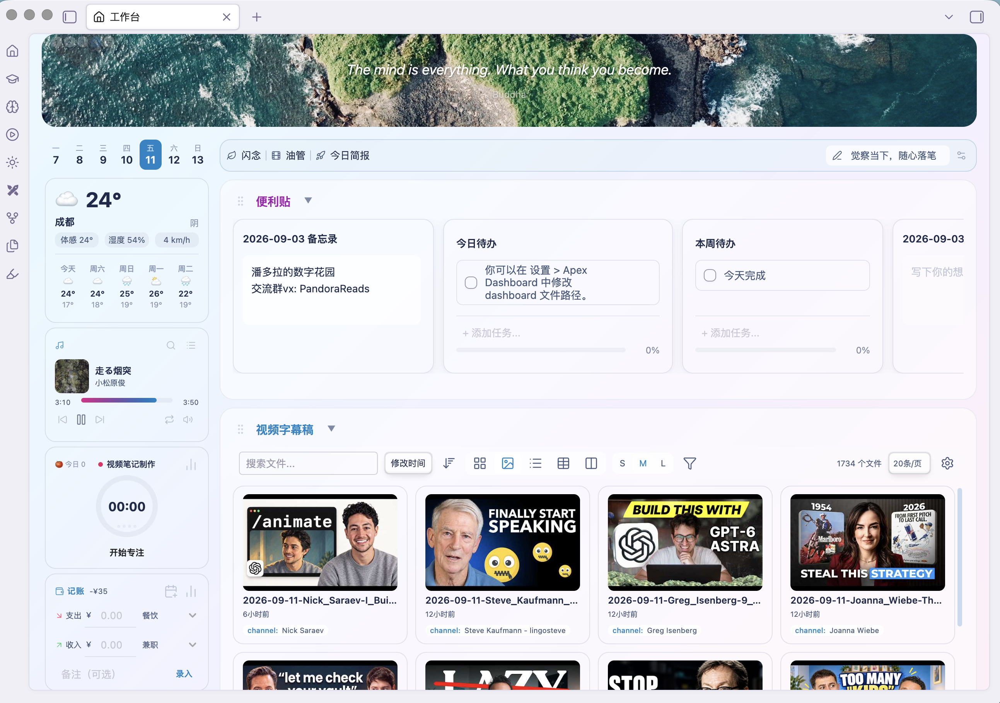
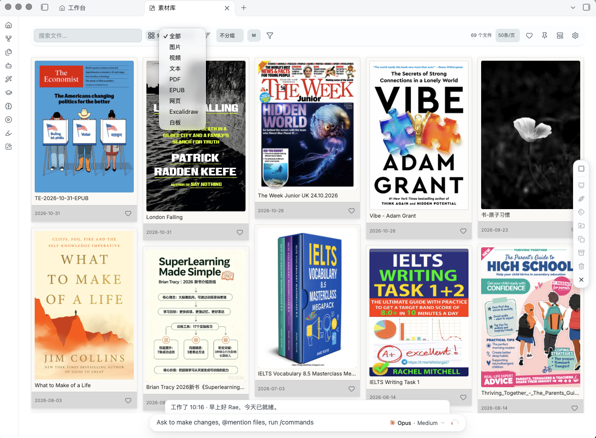
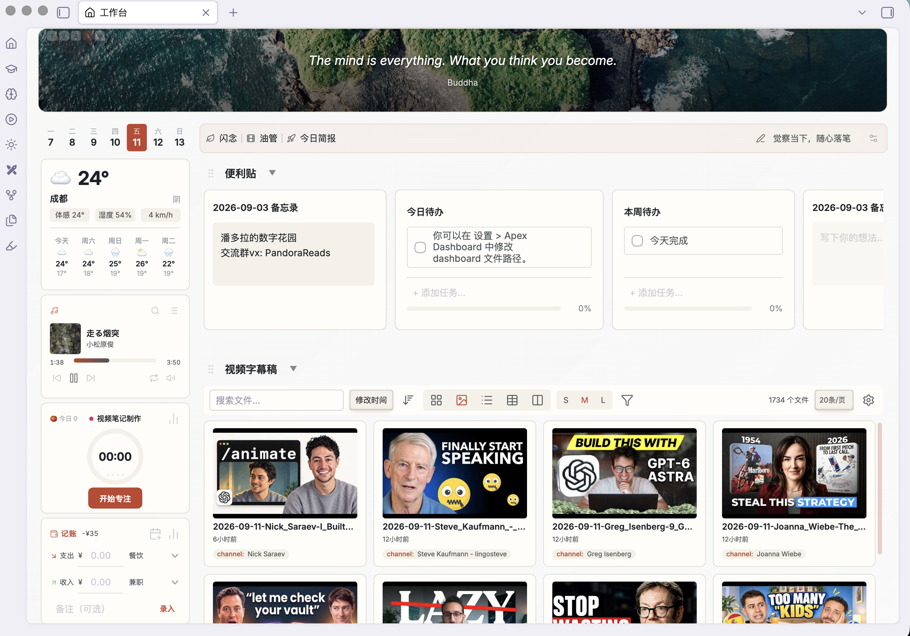
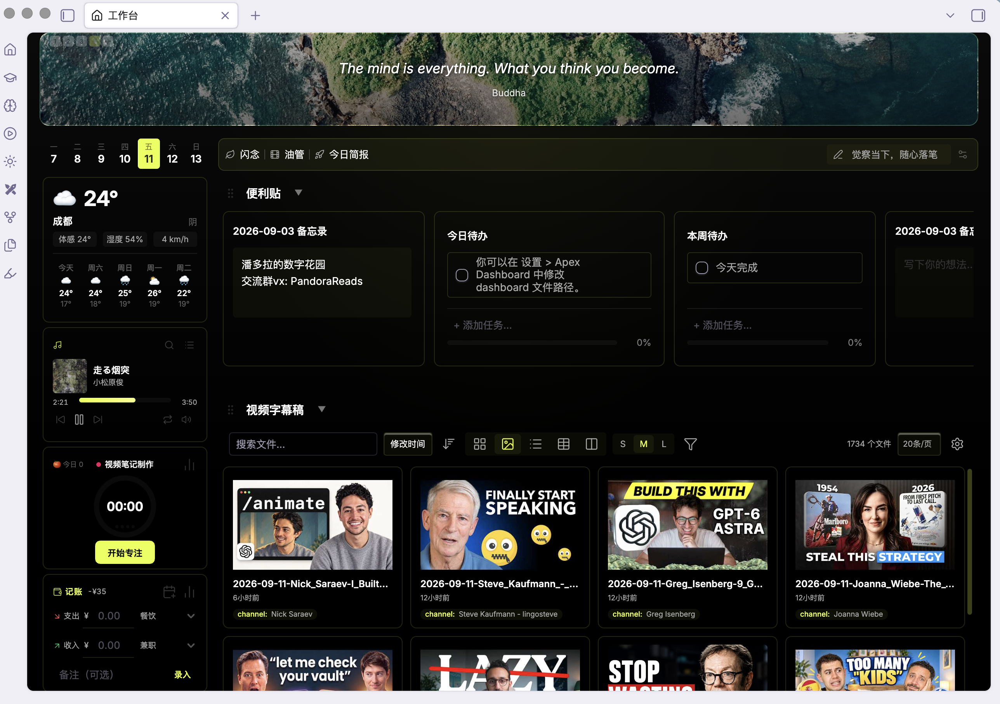

# Apex Dashboard

> Hör auf, zwischen Obsidian-Notizen zu wechseln. Eine Seite. Alles, was du brauchst. Halte deine Gedanken in Memos fest, erledige deine Todos, verfolge deine Projekte — und mach es dabei richtig gut aussehend.

## Screenshot

**Sprache / Language**: [English](README_EN.md) | [简体中文](../README.md) | [繁體中文](README_zh-TW.md) | [日本語](README_ja.md) | [한국어](README_ko.md) | [Español](README_es.md) | [Français](README_fr.md) | **Deutsch** | [Português (Brasil)](README_pt-BR.md) | [Русский](README_ru.md) | [ไทย](README_th.md)

## Funktionen

Beginne mit dem, was heute ansteht. Halte Notizen, Aufgaben, Materialien und alltägliche Werkzeuge auf einer Seite bereit.

**Hier geht es los:** Öffne das Dashboard über das Haus-Symbol in Obsidian links und wähle **+ Abschnitt hinzufügen** sowie einen Bereichstyp. Alternativ suche in der Befehlspalette nach **Apex Dashboard: Neuen Abschnitt hinzufügen**. Alle folgenden Anleitungen zum Hinzufügen von Bereichen beginnen hier. Widgets aktivierst du unter **Einstellungen → Apex Dashboard → Widgets**.

### Ideen festhalten und Aufgaben daraus machen

Schreibe spontane Ideen und Besprechungsnotizen direkt auf Memo-Karten und speichere sie bei Bedarf als eigene Notizen. Aufgabenkarten helfen bei der Tagesplanung: verschieben, Erledigtes abhaken und den Fortschritt sehen.

**So startest du:** Füge **Haftnotizen** hinzu → **+ Karte hinzufügen** → wähle **Notiz** oder **Alles**. Beide Kartentypen können nebeneinander stehen. Mit `[[Notizname]]` verlinkst du bestehende Notizen.

**Weiter ordnen:** Ziehe eine Aufgabe unter eine andere, um eine Unteraufgabe anzulegen. Über die Glocke stellst du eine Erinnerung ein; die Aufgabe erscheint dann auch im Kalender-Widget. Erledigte Aufgaben lassen sich mit einem Klick archivieren.

**Speicherorte festlegen:** Unter **Einstellungen → Apex Dashboard → Allgemein** bestimmt **Memo-Notiz-Speicherpfad**, wo Memos als Notizen gespeichert werden. In **Aufgabenarchiveinstellungen** wählst du die heutige Tagesnotiz oder eine bestimmte Datei. Für eine Datei trägst du **Pfad der Aufgabenarchivdatei** ein.

### Den Vault mit Ordnern und Datenbankansichten organisieren

Mit **Ordner** suchst du nach Ablageort, mit **Bibliothek** sammelst du Notizen nach Zweck, Status oder Tag. Zusammen werden daraus Materialsammlungen, Leselisten oder Schreibboards.

**Nach Ordner:** Füge **Ordner** hinzu und wähle in der Konfiguration einen Ordner. Zeige dessen Notizen bei Bedarf einschließlich Unterordnern an. Neue Notizen erscheinen, ohne sie manuell zu Karten hinzuzufügen.

**Nach Kriterien:** Füge **Bibliothek** hinzu → lege Eigenschaften und Filter fest → wähle Karten, Liste, Tabelle oder Board. Sammle etwa Notizen mit dem Status „Wird gelesen“ aus mehreren Ordnern oder gruppiere Entwürfe nach Bearbeitungsstand.

**Aus Vorlage beginnen:** In den Abschnitts-Einstellungen lassen sich Vorlagen für neue Notizen festlegen; Vorlagen-Eigenschaften übernimmt die neue Notiz, bei Namenskonflikt mit einem Abschnittsfilter gewinnt der Filterwert. Bei mehreren Vorlagen bietet der Neu-Button eine Auswahl, die erste ist Standard.

### Projekte voranbringen

Halte Ziele, Phasen, Meilensteine, Aufgaben und Dateien eines Projekts zusammen. So siehst du den aktuellen Stand und den nächsten Schritt. Mehrere Projekte lassen sich nach Phase oder Gruppe anzeigen und nach Abschluss archivieren.

**So startest du:** Füge **Projekte** hinzu → **Konfigurieren** → lege **Projektordner** und Phasen fest → **Neues Projekt**. Gib Name, Ziel und aktuelle Phase ein. Im Projekt ergänzt du Meilensteine, Aufgaben, Arbeitsnotizen oder Links auf bestehende Dateien. Lege vor dem Archivieren **Archivordner** in den Bereichseinstellungen fest.

### Den Tag im Kalender planen

Der Kalender sammelt automatisch Aufgaben mit Fälligkeit, geplantem Termin oder Erinnerung aus den Notizen im gesamten Vault. Wechsle zwischen Monats- und Wochenansicht und hake Aufgaben direkt ab.

**So startest du:** Füge **Kalender** hinzu oder aktiviere das Widget unter **Einstellungen → Apex Dashboard → Widgets → Kalender**. Auch das Widget kann Aufgaben anzeigen, anlegen und abschließen und lässt sich vergrößern.

**Aufgaben anlegen:** Klicke auf ein Datum. Neue Aufgaben landen standardmäßig in der Tagesnotiz dieses Datums. Unter **Einstellungen → Apex Dashboard → Widgets → Kalender → Aufgabenziel** kannst du eine bestimmte Datei, Tagesnotizen in einem Ordner oder eine eigene Notiz je Aufgabe wählen. Ist die Tagesnotiz im Standardmodus nicht verfügbar, versucht das Plugin, in die Aufgabenliste des Dashboards zu schreiben.

### Gewünschte Notizen und Aufgaben zusammen anzeigen

Nutze eine Beispielabfrage für offene Aufgaben, diese Woche erstellte Notizen oder besonders gut bewertete Bücher. Ein zusätzliches Dataview-Plugin ist nicht nötig.

**So startest du:** Füge **Datenansicht** hinzu → öffne die Konfiguration → wähle **Beispielabfragen** und passe Ordner sowie Bedingungen an. Nach Änderungen aktualisierst du die Ergebnisse mit der Schaltfläche des Bereichs.

### Websites und abonnierte Artikel im Dashboard lesen

Halte häufig besuchte Websites griffbereit, lies abonnierte Blogs an einem Ort und speichere interessante Artikel als Notizen.

**Website öffnen:** Füge **Web** hinzu und trage die Adresse ein. Die Anzeige lässt sich skalieren. Auf dem Smartphone kannst du nicht einbettbare Websites im Browser öffnen.

**Artikel abonnieren:** Füge **RSS** hinzu → klicke auf das Zahnrad → trage die Feed-Adresse der Website ein. Öffne Artikel zum Lesen oder speichere sie über den Download-Button im Vault. Den Zielordner wählst du in den Bereichseinstellungen.

Mit einem WeRead- oder TickTick-Konto kannst du die entsprechenden Bereiche hinzufügen, um Bücher zu sehen, Markierungen zu importieren oder Aufgaben zu verwalten. Verbinde die Dienste zuerst in den Plugin-Einstellungen: Nutze bei WeRead **API-Schlüssel abrufen** und trage die Zugangsdaten ein; bei TickTick öffnest du am Desktop das Anmeldefenster.

### Materialien visuell durchstöbern und ordnen

Bündle Bilder, Videos, PDFs, EPUB-Bücher, HTML-Seiten, Excalidraw-Zeichnungen und Canvas-Boards. Suche nach Typ, Ordner oder Tag, markiere Favoriten und versehe mehrere Dateien zugleich mit Tags, verschiebe oder archiviere sie. Bei Bildern und Videos findest du auch die Notizen, die darauf verweisen.

**So startest du:** Suche in der Befehlspalette nach **Apex Dashboard: Materialbibliothek öffnen** oder nutze das Bibliothekssymbol in Obsidian links. Wähle in den Bibliothekseinstellungen die anzuzeigenden Ordner. Ziehe Bilder oder Videos vom Computer hinein, um sie zu importieren. Direkt im Dashboard kannst du dafür **Bilder** oder **Videos** hinzufügen.

**Direkt ablegen:** Hineingezogene Materialien landen im Importordner aus den Einstellungen; bei Ordner-Gruppierung direkt im Ordner der Gruppe, bei Tag-Gruppierung wird der Tag automatisch gesetzt.

**Sammlungen speichern:** Lege einbezogene und ausgeschlossene Ordner fest, dann klicke auf die Pinnnadel → **Aktuelle Einstellungen als Seite speichern**. Benenne die Seite etwa „Bücherregal“ oder „Inspiration“. Eine gespeicherte Seite stellt ihre Ordnerauswahl wieder her; so wechselst du mit einem Klick zwischen Sammlungen.

**Mit Materialien kreativ arbeiten:** Füge in den Bibliothekseinstellungen unter **An-Agent-Senden-Schaltflächen** einen Button hinzu. Wähle ein KI-Werkzeug auf deinem Computer und trage einen Skill-Namen oder eine Anweisung ein. Wähle Materialien aus und klicke den Button, um ihre Dateipfade zusammen mit der Anweisung weiterzugeben. Installiere das Werkzeug vorher und, wenn du einen Skill nutzt, auch diesen.

### Häufige Aktionen mit einem Klick ausführen

Mache häufig genutzte Notizen, das Anlegen der Tagesnotiz und wichtige Befehle zu Buttons. Die zuletzt verwendeten Dokumente in der Seitenleiste bringen dich zurück zur letzten Arbeit.

**Zugriffe einrichten:** Unter **Einstellungen → Apex Dashboard → Allgemein → Gemeinsame Aktionen** konfigurierst du angeheftete Notizen, Befehle und neue Notizen aus Vorlagen. Bei den Schnellbuttons in der Seitenleiste fügt **+ Aktion hinzufügen** eine Datei oder einen Befehl hinzu.

**KI-Skills aufrufen:** Wähle bei den häufigen Aktionen **Schaltfläche „Skill hinzufügen“.** und gib Button-Name, Skill und KI-Werkzeug an. Klicke den Button, ergänze die Anweisung, prüfe die Vorschau und sende sie. Installiere den Skill und aktiviere ein Plugin wie Claudian oder Copilot beziehungsweise die passende Desktop-App. Codex Desktop öffnet einen neuen Chat mit vorbereitetem Text; starte ihn mit Enter in Codex.

### Alltagswerkzeuge nach Bedarf aktivieren

Unter **Einstellungen → Apex Dashboard → Widgets** aktivierst und konfigurierst du die Werkzeuge. Platziere häufig genutzte zusammen und ändere die Reihenfolge durch Ziehen.

| Was du tun möchtest | Aktivieren | Erste Schritte |
| --- | --- | --- |
| Konzentriert arbeiten | Pomodoro-Timer | Aktivität wählen, Timer starten und später die Sitzungen ansehen |
| Lesefortschritt erfassen | Lese-Tracker | Buch suchen oder manuell anlegen und Seitenzahl eintragen |
| Gewohnheit aufbauen | Gewohnheits-Tracker | Gewohnheit anlegen, täglich abhaken und Serie verfolgen |
| Einnahmen und Ausgaben notieren | Spesen-Tracker | Betrag und Kategorie eingeben, Auswertung im Kassenbuch ansehen |
| Auf ein Datum hinzählen | Countdown-Widget | Name und Zieldatum eintragen |
| Geburtstage und Jahrestage merken | Jahrestage | Datum nach Sonnen- oder chinesischem Mondkalender und jährliche Erinnerung festlegen |
| Wetter prüfen | Wetter | Stadt suchen und Wetter sowie Vorhersage ansehen |
| Mondkalender und Feiertage ansehen | Mondkalender | Für das heutige Monddatum und Feiertage aktivieren |
| Jahresfortschritt sehen | Jahresfortschritt | Aktivieren, um den verstrichenen Jahresanteil zu sehen |
| Aufgaben ansehen und planen | Kalender | Datum anklicken, Aufgaben ansehen oder hinzufügen, Monat/Woche wechseln |
| Fotos als Diashow anzeigen | Fotoalbum | Album hinzufügen, Bildordner und Wechselintervall wählen |
| Musik bei der Arbeit hören | Musik-Player | Am Desktop Titel suchen oder NetEase-Playlist importieren; Anmeldung in den Musikeinstellungen, Wiedergabe gemäß Kontoberechtigung |
| Dateien schnell finden | Dateisuche | Stichwörter eingeben und Vault-Dateien aus den Treffern öffnen |
| Einen Gedanken festhalten | Schnelle Aufnahme | Text eingeben und sammeln; Speicherort wie in der Erfassung der häufigen Aktionen |
| Einen KI-Skill starten | Widget für Fertigkeitsschaltflächen | Skill-Buttons und KI-Werkzeug konfigurieren, Vorschau prüfen und senden |
| Datei öffnen oder Befehl ausführen | Schnellschaltflächen | Aktion hinzufügen, Datei oder Befehl wählen und benennen |

### Die Seite passend einrichten

Kombiniere Bereiche, verschiebe Karten und sortiere Aufgaben sowie Notizlinks. Weniger genutzte Bereiche klappst du über den Button neben dem Titel ein.

**Anordnung ändern:** Ziehe eine Karte an der Titelleiste. Benenne Bereiche per Doppelklick auf den Titel um; ein Doppelklick auf das Banner ändert Zitat und Hintergrund. Farben wählst du aus den unten vorgestellten Themes.

**Immersives Layout anpassen:** Aktiviere zuerst **Layout bearbeiten**. Verschiebe Karten, Bereiche und Widgets frei und ändere ihre Größe an der unteren rechten Ecke. Wähle danach **Layout sperren**. Den Posterhintergrund änderst du über die Anpassung des Erscheinungsbilds.

## Themes

13 handgefertigte Themes, jedes mit eigenem visuellen Charakter:

| Theme | Stil |
|-------|-------|
| **Earth** | Toskanische Sonne: Pergament mit 32 s driftenden warmen Farbwaschungen, Terrakotta-Akzent und Olivnoten |
| **Nordic** | Polare Fjorde: Frost-Aurora-Waschungen über kühlem Weiß, Gletscher-Teal-Akzent |
| **Pony** | Hochgesättigter MLP-inspirierter Regenbogen: sechs Candy-Aurora-Bänder über einem Nachthimmel, eine Pony-Farbe pro Bereich |
| **Blossom** | Rosafarbener Glasschein, transparente Bereiche |
| **Lilac** | Impressionisten-Beet: langsame 28 s driftende Waschungen hinter durchscheinenden Elfenbein-Karten, Flieder-Akzent |
| **Island** (Standard) | Animal-Crossing-Pastelltöne, Waldgrün und Ozeanblau |
| **Tundra** | Kaltgrau + Avocadogrün-Aurora, Salbei-Glaskarten |
| **Matcha** | Teeschalen-Ästhetik: 26 s Tee-Garten-Waschungen, cremefarbene Keramikkarten, tiefer Matcha-Akzent mit Goldnoten |
| **Vermilion** | Tuschminimalismus: Reispapier-Grund und Sumi-Tinte, 40 s Tuschewaschungs-Drift, ein Zinnober-Siegel-Akzent |
| **Neon** | Fast-Schwarz mit Neonmagenta-Akzent, identisch in Hell & Dunkel |
| **Volt** | Fast-Schwarz mit elektrischem Cyan-Akzent, identisch in Hell & Dunkel |
| **Magma** | Warmes Fast-Schwarz mit Lavaorange-Akzent, identisch in Hell & Dunkel |
| **Onyx** | Reines Schwarz mit Zitronen-Akzent, identisch in Hell & Dunkel |

Alle Themes unterstützen sowohl den hellen als auch den dunklen Modus von Obsidian.

## Einstellungen

- **Dashboard-Datei** — passe den Dateipfad für deine Dashboard-Daten an
- **Stil** — wähle aus 13 visuellen Themes
- **Sprache** — englische oder chinesische Oberfläche
- **Anzahl letzter Dokumente** — steuere, wie viele letzte Dateien erscheinen
- **Seitenleisten-Widgets** — Wetter, Heatmap, Pomodoro, Lesen, Countdown. Aktiviere/deaktiviere und konfiguriere jedes Widget unabhängig
- **Leseeinstellungen** — Lese-Tracker umschalten, Sound beim Abschluss einer Sitzung ein-/ausschalten
- **Eigene Skill-Ordner** — lokale Ordner (komma-getrennt), in denen Skill-Picker Skill-Namen finden; leer = aus, es wird nie etwas außerhalb des Tresors gelesen. Nur Desktop

## Installation

### Aus den Obsidian Community Plugins
1. Öffne Einstellungen > Community Plugins
2. Durchsuche und suche nach „Apex Dashboard“
3. Klicke auf Installieren, dann auf Aktivieren

### Manuelle Installation
1. Lade die neueste Version von [GitHub Releases](https://github.com/pandorareads/apex-dashboard/releases) herunter
2. Entpacke sie in den Ordner `.obsidian/plugins/apex-dashboard/` deines Vaults
3. Öffne Einstellungen > Community Plugins und aktiviere „Apex Dashboard“

## Verwendung

1. Öffne das Dashboard über das Ribbon-Symbol (Haus-Symbol) oder die Befehlspalette: `Apex Dashboard: Open dashboard`
2. Eine `dashboard.md`-Datei wird automatisch im Vault-Root erstellt
3. Alle Änderungen werden direkt in der Datei gespeichert — es sind deine Daten, im Klartext

> **Hinweis:** Löschen, Umbenennen oder Neuanordnen von Bereichen muss durch direktes Bearbeiten der Datei `dashboard.md` erfolgen. Jede Änderung an der Notiz wird sofort in der Dashboard-Ansicht wirksam.

## ☕ Kauf mir einen Kaffee

Wenn Apex Dashboard deinen täglichen Obsidian-Workflow reibungsloser macht, spendiere mir gerne einen Kaffee, um die Weiterentwicklung zu unterstützen.

  

## Was ist neu

### 3.9.6
- **Einführungstour** — Eine Spotlight-Tour startet bei der Erstinstallation automatisch (nur Desktop): Sie hebt Schritt für Schritt die echten Bedienelemente hervor — Arbeitsoberfläche öffnen, Seiten wechseln, Banner bearbeiten, Seitenleiste anheften, Abschnitte hinzufügen — und schreitet beim Anklicken weiter; „Einführungstour erneut ansehen" in der Befehlspalette öffnet sie jederzeit
- **Vereinheitlichte Konfigurationsdialoge** — Eingabefelder in allen Abschnitts-Dialogen zeigen jetzt im Ruhezustand eine graue Haarlinie und bei Fokus eine Akzentlinie; Inline-Beschriftungen umbrechen nie mehr; Skill-/Button-Karten lesen sich als eine ausgerichtete Spalte (Icon + Label + Löschen in der ersten Zeile, die folgenden eingerückt), Icon-Wahl, Eingaben und Buttons teilen sich ihre Zeile; der Direkt-Send-Haken sitzt links neben seinem Text
- **Schlankere Hinweistexte** — 33 Konfigurations-Hinweise wurden im „leer = X"-Muster in allen 11 Sprachen neu geschrieben, ohne Erklärungen, die die Oberfläche schon zeigt; die herausgewanderten Regeln (Vorlagen-Eigenschaften, Ablege-Verhalten bei Gruppen, Skill-Ordner-Datenschutz) stehen jetzt in den README-Kapiteln
- **Echtes Masonry auf Mobil** — Handys und Tablets erhalten den zweispaltigen gestaffelten Kartenfluss: Bilder legen sich in ihr echtes Seitenverhältnis, gemessen wird nur die sichtbare Seite statt des ganzen Tresors im Hintergrund
- **Musik-Widget-Fixes** — Angefrage-Playback-Anfragen tragen jetzt die PC-Client-Cookies und umgehen die CDN-Knoten, die Electron mit 403 abwiesen (rund drei Viertel der Titel scheiterten stumm); Playlist-Importe nutzen den v6-Endpunkt, sodass Listen über 10 Titel nicht mehr abgeschnitten werden
- **PM-Karten Geld-Leiste** — Neue Option „Einnahmen & Restzahlung anzeigen" blendet die Geld-Leiste für Abschnitte ohne Geldflüsse aus

### 3.9.5
- **Dokumenttypen in der Materialbibliothek** — PDF, EPUB, gespeicherte HTML-Seiten, Excalidraw-Zeichnungen und Canvas-Boards erscheinen jetzt als Kacheln: EPUB-Cover werden aus dem Buch extrahiert, PDFs rendern die erste Seite, HTML-Seiten erhalten einen Erstbild-Schnappschuss, Zeichnungen und Boards werden als Miniaturen skizziert, und alles ohne Cover zeigt eine Typsymbol-Karte; Typfilter und Typgruppierung wurden erweitert, ein Klick öffnet jede Datei nativ (HTML Reader, PDF-Ansicht, Boards — Erweiterungen ohne Ansicht gehen an die Standard-App des Systems)
- **Pin-Seiten per erneuten Speichern aktualisieren** — erneutes Speichern unter einem bestehenden Seitennamen aktualisiert die Seite mit den aktuellen ausgeschlossenen Ordnern, statt eine doppelte Zeile zu stapeln; behoben: Klick auf HTML- und andere Nicht-Notiz-Dateien öffnete eine leere Datei

### 3.9.4
- **Ordnerseiten in der Materialbibliothek (Pin)** — eine neue Pin-Schaltfläche rechts vom Favoriten-Herz speichert den aktuellen Scan-Bereich und die ausgeschlossenen Ordner als benannte Seite; ein Klick auf eine gespeicherte Seite wechselt die OrdnerEinstellungen auf einen Schlag, das × löscht sofort, und die Seiten synchronisieren über data.json geräteübergreifend

### 3.9.3
- **Archivieren in der Materialbibliothek** — neuer Archivieren-Button in der rechten Aktionsleiste verschiebt die Auswahl in den in den Einstellungen gesetzten Archivordner; ohne Ordner erscheint ein Hinweis zur Einrichtung
- **Referenzierende Notizen im Lightbox** — die Bild-/Video-Ansicht listet unten alle Notizen, die das Material verlinken oder einbetten, mit Ein-Klick-Sprung
- **Bequemer taggen** — das Stapel-Tag-Popup bietet vorhandene Tags als Ein-Klick-Chips; die Filter-Tags umbrechen auf mehrere Zeilen mit Kürzung langer Namen, und der Leeren-Button hat jetzt die richtige Beschriftung und erscheint sofort beim Filtern
- **Klicks folgen den Arbeitsbereich-Einstellungen** — Textkarten der Materialbibliothek öffnen wie Dashboard-Karten nach der Popover-/Tab-Einstellung
- **Rendern stabiler** — Filter- und Seitenwechsel zeichnen sich in einem Durchgang (Vorab-Messung der Seitenverhältnisse plus Wiederverwendung der Bildelemente) und springen weniger

### 3.9.2
- **Sofortiger Theme-Wechsel in der Medienbibliothek** — die Medienseite passt ihr Theme jetzt an Ort und Stelle an, sobald du das Plugin-Theme wechselst, genau wie das Dashboard-Board, ohne Schließen und erneutes Öffnen; eigene Farben, Hintergrundbild und Appearance-Einstellungen gelten jetzt auch für die Medienseite
- **Typfilter kollabiert zu einem Dropdown** — der Bild-/Video-/Text-Filter wurde zu einem einzelnen Dropdown-Button für eine ruhigere Toolbar, und die Paginierung ist jetzt flach, sodass jedes Medium direkt erreichbar bleibt
- **Neue Farbpalette für den Karten-Basisstreifen** — der untere Meta-Streifen der Polaroid-Karte nutzt jetzt ein handverlesenes Farbset, das sich heller und dunkler Modus teilen

### 3.9.1
- **500er-Obergrenze der Medienbibliothek entfernt** — Bisher wurde eine einzelne Darstellung hart auf 500 Einträge abgeschnitten: Überschüssige Medien ließen sich nicht erreichen, und in der Gruppenansicht gingen ganze Gruppen samt Ordner verloren. Jetzt gilt: Die Kachelansicht blättert paginiert durch alle Medien, die Gruppenansicht rendert jede Gruppe progressiv (erste 50 Karten + „Mehr anzeigen“), und eingeklappte Gruppen bauen ihren Inhalt gar nicht erst auf — sehr große Vaults verlieren keine Medien mehr, und es werden nicht mehr auf einen Schlag zehntausende Knoten gemountet
- **Drag-&-Drop-Verschieben in Ordnergruppen** — In der Ordnergruppenansicht ein Medienkärtchen in eine andere Gruppe ziehen verschiebt die Datei: Mehrere ausgewählte Karten gemeinsam ziehen verschiebt sie im Stapel, Namenskonflikte werden automatisch übersprungen und gemeldet, und beim Darüberfahren über die Zielgruppe erscheint „Loslassen, um nach ×× zu verschieben“
- **Spaltenlayout der Gruppen korrigiert** — Nach Abschluss der Seitenverhältnis-Erkennung der Bilder ordnen sich die Wasserfall-Spalten jetzt in jeder Gruppe neu an (bisher nur in der ersten Gruppe)

### 3.9.0
- **Völlig neue Medienbibliothek** — Neues square-sparkles-Icon im linken Funktionsbereich öffnet die Vollseiten-Medienbibliothek: Bilder, Videos und Notizen mit Cover aus dem Vault fließen zusammen in einem Wasserfall
- **Zwei Kartenstile** — Original-Cover-Karte / Polaroid-Karte im Pin-Stil mit einem Klick umschalten, drei Dichtestufen, Gruppieren nach Ordner, Tag oder Typ; die Gruppenansicht bietet eine linke Navigationsleiste und Ein-Klick-Einklappen
- **Favoriten** — Klicke auf das Herz auf der Karte, um ein Medium zu favorisieren; der Herz-Button in der Toolbar zeigt mit einem Klick nur Favoriten
- **Stapelverarbeitung** — Ziehe einen Rahmen für die Mehrfachauswahl, und die Icon-Funktionsleiste rechts versieht sie stapelweise mit Tags, verschiebt sie, kopiert Pfade und löscht sie
- **Agent-Anbindung** — Ausgewählte Medien mit einem Klick an eine Agent-Fähigkeit übergeben, der Pfad wird automatisch in die Prompt-Vorlage übernommen
- **Ablegen heißt Speichern** — Ziehe Bilder/Videos von irgendwo auf dem Rechner hinein: Sie werden automatisch in den Vault kopiert, anhand der Gruppierung abgelegt und getaggt; der Standard-Ablageort ist in den Einstellungen konfigurierbar

### 3.8.11
- **Mehrsprachige Oberfläche erweitert** — Neu dazu kommen Japanisch, Koreanisch, Spanisch, Französisch, Deutsch, Brasilianisches Portugiesisch, Russisch und Thailändisch; zusammen mit vereinfachtem Chinesisch, traditionellem Chinesisch und Englisch werden 11 Oberflächensprachen unterstützt. Bei neuer Installation folgt die Oberfläche der Obsidian-Sprache, lässt sich aber auch über die Einstellungen oder die Sprachauswahlliste wechseln; die Übersetzungen sind offline eingebunden
- **Immersiver-Arbeitsbereich-Aussehen** — Das Hintergrundbild lässt sich unabhängig vom normalen Arbeitsbereich einstellen, und die Schriftart sowie Farbe der oberen Uhr sind anpassbar; der Bearbeitungseingang ist unter dem Layout-Bearbeiten-Button zusammengeräumt
- **Zählmodus für Gewohnheiten** — Gewohnheiten lassen sich auf wiederholtes Klicken zum Aufsummieren der Zählwerte umstellen; das Widget zeigt die Tageszählung, und das Statistik-Panel unterstützt das Ansehen kumulierter Daten sowie den Moduswechsel
- **Sprung über Eigenschaftsgruppen-Links** — Gruppieren Ordner- oder Datenbank-Bereiche nach einer Backlink-Eigenschaft, öffnet ein Klick auf den Gruppennamen die Zielnotiz
- **Countdown- und Web-Fixes** — Die Zielzeit-Auswahl-Interaktion des Countdowns wurde repariert; die Google-OAuth-Anmeldung springt in einen externen Browser, um die Autorisierung fortzusetzen
- **Mehrsprachige Anzeige vervollständigt** — Kalender, Wetter, Mondkalender und Jahresfortschritt zeigen ihre Oberflächeninhalte in der aktuellen Sprache an

### 3.8.8
- **Pipeline-Archivierung gehärtet** — Die Archivierung verschiebt jetzt zuerst die Datei, verifiziert, dass die Umbenennung tatsächlich angekommen ist (mit einem automatischen Wiederholungsversuch), und stempelt erst dann den Status: Stumme Verschiebefehler auf iCloud-synchronisierten Vaults stranden keine halb archivierte Notiz mehr in ihrem Stage-Ordner (vier Vorkommnisse diagnostiziert). Eine fehlgeschlagene Verschiebung meldet sich und lässt die Karte auf dem Board, sodass ein weiterer Klick es einfach erneut versucht. Stage-Drag-Verschiebungen erhalten dieselbe Absicherung
- **Karten-Skill-Button-Drag-Neuanordnung behoben** — Grundursache gefunden: Selbst wenn der native Drag der Karte abgebrochen wurde, gab Chromium weiterhin die Pointer-Capture des Buttons frei, was die button-lokalen move/up-Listener augenblicklich außer Kraft setzte, sobald der Zeiger den 22-px-Button verließ — genau das, was eine button-übergreifende Neuanordnung braucht. Die Geste fährt nun auf dokumentweiten Capture-Listenern: Live-Tauschen beim Ziehen, Reihenfolge beim Loslassen gespeichert, und ein Drop auf einem anderen Skill-Button kann dessen Modal nicht mehr versehentlich öffnen
- **Eigene Start-Buttons auf Skill-Bibliothek-Karten** — Das Kartenmenü erhält „Start-Buttons konfigurieren…“: wähle pro Skill einen beliebigen Agenten, Label, Icon, Prompt-Vorlage und Direkt-Senden-Schalter. Eigene Buttons erscheinen neben den automatischen Quellen-Buttons — Skills aus eigenen Ordnern (die keinen Agenten binden) bekommen endlich einen Senden-Einstieg, gespeichert mit dem Bereich
- **Pipeline-Konfigurations-Modal-Layout** — Die Agenten-Auswahl ist ein fester schmaler Slot neben dem Skill-Namen-Eingabefeld (langer „coming soon“-Optionstext sprengt die Zeile nicht mehr), und Prompt-Vorlagen erhalten ein Volltext-Popup — lies und bearbeite das Ganze in einem hohen Fenster, wobei Änderungen live zurückstreamen
- **Freiraum am unteren Dashboard-Rand** — Am Scroll-Ende heben sich der letzte Bereich und der Bereich-hinzufügen-Button jetzt frei von einem unten angedockten KI-Chat-Fenster (60 → 200 px auf dem Desktop); Telefone und das immersive Layout behalten ihre eigenen Werte

### 3.8.7
- Traditionelles Chinesisch als Sprachversion; das Blossom-Theme als Barbie neu gebaut; Immersive-Kachel-Überlappungsfix, progressives Rendering für Pipeline-/PM-Bereiche und das Entfernen der mobilen Bereichsleiste — siehe die 3.8.7-Release-Notes

### 3.7.1
- **Völlig neuer RSS-Bereich** — Abonniere jeden RSS 2.0-/Atom-Feed und alle Quellen fließen in einem umgekehrt chronologischen Stream zusammen: Unread-Punkte und Unread-Filter, Buckets nach Gruppe oder nach Feed (verwaltete Gruppenliste, direkt aus einer Feed-Zeile erstellbar), und Paginierung mit konfigurierbarer Seitengröße (10/20/50/100). Klicke auf einen Artikel, um ihn in einem thematisierten Reader-Modal zu lesen — reine Zusammenfassungs-Feeds lassen ihre vollständige Seite automatisch abrufen und den Hauptinhalt extrahieren, mit Fallback auf die Zusammenfassung plus einen „Im Browser öffnen“-Button. Jeder Artikel wird mit einem Klick als Notiz in den Vault gespeichert (Frontmatter spiegelt die 「01 收集」-Inbox-Vorlage wider und speist die PARA-Pipeline), und gespeicherte Einträge springen direkt zu ihrer Notiz. OPML-Import (Kategorien werden Gruppen, URL-dedupliziert) und Export inklusive. Feeds werden 30 Minuten lokal zwischengespeichert (fehlgeschlagene Quellen wiederholen nach 5 Minuten, vier parallele höfliche gleichzeitige Abrufe), und fehlschlagende Feeds werden pro Zeile mit ihrem Grund im Konfigurations-Modal genannt. Die Aufbewahrung der Gelesen-Markierungen ist eine Einstellung (30/90/180/365 Tage oder für immer)
- **Lesbarkeits-Fixes im Immersive-Layout** — unsichtbarer Eingabetext in hellen Obsidian-Sitzungen (Obsidians Eingabe-Regeln hatten Vorrang vor denen des Plugins) und ausgewaschene weiße Kanban-Spaltentitel (ein fehlendes --db-bg im Immersive-Variablenblock) wurden beide an der Wurzel behoben; kleine Icon-Buttons in Bereichen und Modals werden nicht mehr von Obsidians nativem Button-Chrome umgemalt oder gequetscht
- **Ausgaben-Voreinstellungskategorien sind bearbeitbar** — Voreinstellungen verhalten sich jetzt genau wie eigene: Löschen, Neuanordnen und Gruppenzuordnung für alle; die Historie zeigt weiterhin unter entfernten Labels an und freigegebene Namen können neu hinzugefügt werden; jede Richtung behält mindestens eine Kategorie
- **Immersive-Kontextmenü gestrafft** — der schwache „Layout aufräumen“-Eintrag ist verschwunden; „Karte entfernen“ bleibt

### 3.7.0
- **Völlig neues Immersive-Workspace-Layout** — jeder Workspace kann in einen immersiven Modus wechseln: ein randloser Poster-Hintergrund mit Uhr und zentrierter Erfassungsleiste, und jedes Widget, jede Memo und jedes Todo als frei bewegliche Glaskarte — an den Kanten in der Größe ändern, mit intelligentem Snapping ausrichten. Erstelle eines über den +-Button am Workspace-Switcher

### 3.6.6
- **Appearance-Studio gespeicherte Themes** — eigene Looks speichern sich als Themes mit Ein-Klick-Wechsel, plus ein Schnellbefehls-Einstieg
- **Eingabe-Entführungsschilde** — Drittanbieter-Snippets können die Eingabefelder des Dashboards nicht mehr mit globalen Styles kapern
- **Musik-Stiller-Sprung-Fix** — gelegentliche NetEase-Wiedergabefehler überspringen nicht mehr stillschweigend; sie benachrichtigen zuerst je nach Ursache
- **Render-Obergrenze erhöht** — progressives Gruppenrendering begrenzt jetzt bei 500 Elementen, sodass sehr große Bereiche mehr von sich zeigen

### 3.6.5
- **Karten an Ort und Stelle löschen** — Grid-, Galerie- und Kanban-Karten in Datenbank-/Ordner-Bereichen zeigen bei Hover einen Ecken-Papierkorb-Button (auf Mobilgeräten immer sichtbar) — kein Menü-Grabbing mehr
- **Neue Notiz aus mehreren Vorlagen** — Die Einstellung „Vorlage für neue Notizen“ akzeptiert jetzt mehrere Vorlagen; wähle bei jedem Klick auf das Toolbar-+ eine aus, und die Notiz kommt mit den Filtern des Bereichs vorausgefüllt. Einzelvorlagen-Einstellungen migrieren automatisch
- **Tabellenansicht-Spaltensteuerung** — Ein Toolbar-Augen-Button listet jedes Eigenschaftsfeld: verberge, was du nicht brauchst, und ziehe zum Neuanordnen, gemerkt pro Bereich; alte Spalteneinstellungen migrieren automatisch
- **Render-Schutz für große Vaults** — Gruppierte und Kanban-Ansichten rendern progressiv (50 pro Gruppe/Spalte mit einer „Mehr anzeigen“-Pille) und begrenzen bei 2000 Elementen mit einem Hinweis — Bereiche mit tausenden Dateien frieren das Dashboard nicht mehr ein
- **Mond-Jahrestage** — Jahrestagsdaten können lunar sein (verlustfrei als Solar-Daten gespeichert); Erinnerungen mappen auf Mond-Jahrestage
- **Cover- & Banner-Brennpunkte** — Projekt-Cover und Banner-Hintergründe erlauben das Ziehen der Brennposition, gemerkt pro rotierendem Bild
- **Kalender-Aufgabenzeiten & -ziele** — Aufgaben unterstützen Start-/Fälligkeits-/Geplante-Datumsfelder mit optionalen Zeiten über mehrere Tage (`[start::]`/`[due::]`/`[scheduled::]`); ein „Eine Notiz pro Aufgabe“-Zielmodus erstellt/hängt automatisch eine datierte Notiz an
- **Ohne-Cover-Bereiche in Notizen zusammengeführt** — Der Typ „Notizen ohne Cover“ verschmilzt mit „Notizen“ und einem „Cover anzeigen“-Schalter pro Bereich; alte Konfigurationen migrieren automatisch
- **Eigenschaftsfilter für Ordner-Bereiche** — Ordner-Bereiche erhalten denselben Eigenschaftsfilter-Editor wie Datenbank-Bereiche (equals/contains/notEquals)

### 3.6.3
- **Gruppierung für Library-/Ordner-Ansichten** — Grid-, Galerie-, Listen- und Tabellenansichten erhalten einen „Gruppieren“-Toolbar-Button: keine Gruppierung, nach Ordner (Ordner erster Ebene unter den Scan-Ordnern) oder nach jeder Frontmatter-Eigenschaft; die Wahl bleibt pro Bereich in der Board-Datei erhalten; die Kanban-Ansicht behält ihre bestehende Konfigurationsdialog-Gruppierung
- **Alle Gruppen auf-/zuklappen** — Mit aktivierter Gruppierung erhalten Library-/Ordner-Bereiche einen Toolbar-Button, der alle Gruppen mit einem Klick auf- oder zuklappt; Icon und Tooltip folgen dem aktuellen Zustand
- **Größenveränderbarer Widget-Bereich** — Seitenlayout: ziehe die Kante der Seitenleiste, um ihre Breite zu ändern (180–420 px, gemerkt); gestapeltes Layout: ziehe am Widget-Streifen, um seine Höhe festzulegen (240–560 px); Gewohnheits- & Lese-Widget-Höhenstufen (voll / zwei Drittel / halb / ein Drittel) sind in den Einstellungen wählbar
- **Musik-Widget-Wiedergabefix** — Intermittierende NetEase--110-Berechtigungs-Schwankungen erhalten jetzt beabstandete Wiederholungsversuche vor dem Aufgeben, sodass berechtigte Titel nicht mehr übersprungen werden; wirklich nicht abspielbare Titel nennen sich selbst und den Grund (Mitgliedschaft, Kauf oder regionale Rechte) in einem Hinweis, bevor weitergegangen wird — keine stillen Sprünge mehr
- **Ein-Klick-Archivierung in die heutige Tagesnotiz** — Eine neue „Archivierungsziel“-Einstellung: die feste Datei (wie bisher) oder die heutige Tagesnotiz (automatisch aus der Daily-Notes-Kernvorlage erstellt, wenn fehlend); die Archivierung bricht mit einem Hinweis ab, wenn die Tagesnotiz nicht aufgelöst werden kann
- **Eigene Vorlage für Memo-Speichern** — Das Speichern einer Memo-/Sticky-Karte als Notiz unterstützt jetzt eine eigene Vorlage
- **Aktualisierungs-Performance-Fix** — Vault-Änderungen bauen nur die Bereiche neu auf, deren Scan-Umfang den geänderten Pfad abdeckt: das Bearbeiten von Notizen an anderer Stelle, RSS-Drops und Bild-Churn blitzen nicht mehr jeden Library-/Ordner-Bereich auf; ein Bereich, dessen Abfrageergebnisse unverändert sind, überspringt den Neuaufbau vollständig (Out-of-Scope-Edits: 3 Bereiche pro Durchgang → 0)
- **Scrollposition überall bewahrt** — Vollständige Neu-Renders snapshoten den Scroll-Zustand der ganzen Seite (der horizontale Scroll des gestapelten Widget-Decks, die Scroll-Region, Karten-Decks, Aufgabenlisten, widget-interne Listen) und spielen ihn danach exakt ab; ankerbasierte Schlüssel überleben Bereichs-/Widget-Neuanordnungen — wo du gearbeitet hast, bleibst du, kein Zurückspringen nach oben mehr

### 3.6.2
- **Theme-Studio-Farbschemata & Presets** — Jeder Farbbereich erhält ein Schema-Dropdown (Theme folgen / hell / dunkel / eigene, das Widget-Hintergrund-Vordergrund-Rezept) mit Presets pro Feld zum schnellen Wählen
- **Neue Notiz im Notizen-Bereich** — Cover- und Ohne-Cover-Notizen-Bereiche erhalten einen „Neue Notiz“-Button pro Karte, plus Bereichseinstellungen für die Neue-Notiz-Vorlage und den Speicherordner (Vault-Root, wenn nicht gesetzt)
- **Memo-Karten rendern Markdown** — Memo- und Sticky-Karten rendern ihren Inhalt über Obsidians Renderer (zeilenerhaltende Anpassung, bestehende Memos behalten ihr Aussehen)
- **Fix** — Die Neue-Notiz-Vorlage des Ordner-Bereichs wurde beim Speichern der Einstellungen stillschweigend verworfen; Vorlagen-Frontmatter wird jetzt unter den Filter-Props zusammengeführt, mit erhaltenen Rohzeilen

### 3.6.1
- **Bereichs-Toolbars kollabieren zu Dropdown-Buttons** — Der Ansichts-Wechsler und die Kartengröße (S/M/L)-Steuerungen in Library-/Ordner-/Bilder-/Video-Bereichen kollabieren jeweils zu einem einzelnen Button, der die aktuelle Wahl zeigt; ein Klick öffnet das native Menü zur Auswahl — eine viel ruhigere Toolbar
- **Bilder/Videos Anzeige-Umfang** — Eine neue „Anzeige-Umfang“-Einstellung: Mehrfachauswahl von Vault-Ordnern (mit Picker); wenn gesetzt, werden nur Dateien darunter angezeigt (Ausschlüsse gelten weiterhin innerhalb des Umfangs); leer = ganzer Vault
- **Neue-Notiz-Vorlage pro Bereich** — Ordner-/Library-Konfigurationsdialoge erhalten eine „Neue-Notiz-Vorlage“: Notizen, erstellt über das Toolbar-+, starten vom Vorlagenkörper ({{title}} und {{date:…}} ersetzt), mit den Filter-Props des Bereichs weiterhin vorausgefüllt; eine fehlende Vorlage degradiert zu einer nackten Notiz
- **Kalender-Aufgabenziel** — Die Kalendereinstellungen erhalten ein „Aufgabenziel“: behalte die Standardkette (Tagesnotiz des Tages → Dashboard-Todoliste), oder hefte eine bestimmte Datei (oben/unten einfügen) oder einen Ordner fest (eine JJJJ-MM-TT-Notiz pro Tag, automatisch erstellt)
- **Quick-Action-Buttons sind in jedem Theme Glas** — Die Button-Füllungen und -Ränder von Earth/Nordic/Island/Tundra/Matcha/Lilac/Vermilion/Aurora sind jetzt akzentgetönte transluzente Gläser, passend zu den fünf Themes, die es bereits hatten — alle zwölf fühlen sich gleich an
- **Theme-Studio-Alpha + Seitenhintergrund behoben** — Jede Farbreihe erhält einen Opazitäts-Slider (0–100 %); der eigene Seitenhintergrund wird jetzt tatsächlich angewendet (Wasch-Theme-Gradienten werden ebenfalls ersetzt), und Alpha 0 zeigt den Obsidian-Hintergrund
- **Mattes Innenfenster auf Hintergrundbild-Karten** — Mit gesetztem Hintergrundbild schwebt ein eigenständiges Mattglas-Pane über dem Foto (echter Blur + Theme-Karten-Füllung + beleuchtete Oberkante); das Pomodoro-Widget tritt dem Hintergrundbild-Club bei (Zahnrad in seiner oberen Reihen-Gruppe)
- **Viele Verfeinerungen** — Lesezeichen am eingeklappten Banner ziehen sich bis zum Hover zurück; Quick-Actions-Palette-Button entfernt (Bilder + Vordergrundfarben ersetzen ihn); Gewohnheits-Kopf-Buttons immer sichtbar; eigene Vordergrundfarbe kippt jetzt auch geerbten Text (Quick-Action-Labels behoben); behoben: Mond-Widget verlor Drag-Neuanordnung nach asynchroner Aktualisierung (Event-Delegation); behoben: Windows-Paarbreiten-Drag-Ausfall (veralteter Partnerwert-Wrap-Around + Subpixel-Wrapping + von Webviews verschluckte Ereignisse, alle drei Wurzeln)

### 3.6.0
- **Völlig neues gestapeltes Layout** — Einstellungen → Allgemein → Layout erhält illustrierte Auswahl: nebeneinander (klassisch) oder gestapelt — Widgets ordnen sich in ein höhenproportionales Karten-Deck (voll / zwei Drittel / halb / ein Drittel) unter dem Banner, die Schnellnotizen-Leiste bleibt angeheftet, Widgets und Bereiche scrollen als eine Seite, Anheften/Einklappen unverändert; Telefone unbeeinflusst
- **Widget-Hintergründe & Vordergrund-Schemata** — Jahrestag, Countdown, Jahresfortschritt, Musik, Gewohnheiten und Quick Actions unterstützen eigene Hintergründe (Bild-Picker listet nur Bilder, Netzwerk-Bild-URLs willkommen) mit Opazitäts-/Abdunkelungs-/Blur-Slidern und hellen/dunklen/eigenen Picker-Vordergrundfarben; das Zahnrad in der Kartenecke ändert sie, ohne das Dashboard zu verlassen
- **Neues Jahrestag-Widget** — Vergangene Zeit seit einem historischen Datum (Jahre-Monate-Tage / Gesamttage / Tage+Stunden-Präzision), optionaler Jährlicher-Gedenktag-Reminder, nativer Datums-Picker
- **Multi-Instanz-Album-Widget** — Füge beliebig viele Alben hinzu, jedes mit seinem eigenen Ordner und seiner Kartengröße
- **Fix: Paarbreiten-Drag auf Windows defekt** — Alle drei Grundursachen behoben (veraltete Partnerwerte, die Zeilen umbrechen, Subpixel-Rundung, eingebettete Seiten, die Mausereignisse über einen Pointer-Capture-Drag-Guard verschlucken)

### 2.5.3
- **Kategorie-Neuanordnung & primäre Gruppen** — Der „Kategorien verwalten“-Dialog sortiert jetzt per Drag (Voreinstellungen inklusive; die Eintrags-Dropdowns und Ledger-Filter folgen; Hoch/Runter-Buttons decken Touch ab). Eine neue Primärgruppen-Ebene: erstelle Gruppen, weise Kategorien zu, und das Ledger erhält eine „Primär“-Spalte plus einen Gruppenfilter (mit einem „Nicht gruppiert“-Bucket); das Statistik-Donut und die Rangliste schalten zwischen Kategorie- und Gruppenaggregation um. Gruppierung wird separat gespeichert, sodass Neugruppierung die gesamte Historie neu einordnet, ohne einen Datensatz anzufassen
- **Historie nach Woche & Monat** — Der Statistik-„Historie“-Bereich erhält eine Woche/Monat/Jahr-Unterschaltung mit ‹ ›-Blättern: betrachte jede vergangene Woche (beschriftet mit ihrem Zeitraum), Monat oder Jahr; KPI-Deltas vergleichen mit der vorherigen gleichen Periode, und Trends plotten täglich für Wochen/Monate und monatlich für Jahre; Blättern stoppt an der aktuellen Periode und dem ältesten Jahr mit Daten
- **Fix: KPI-Delta-Chips drängten die Zahl** — Ausgaben- und Pomodoro-Statistikkarten geben dem Wert jetzt eine eigene zentrierte Zeile, mit dem Perioden-über-Perioden-Chip darunter umgebrochen und zentriert — kein Quetschen oder Überlaufen der Karte mehr

### 2.5.2
- **Musik-Wiedergabe-Selbstheilung** — Ein vorübergehender Fehler poppt nicht mehr „Wiedergabefehler, springe zum nächsten Titel“ und verliert den Song dauerhaft: er wiederholt denselben Titel stillschweigend einmal mit einem frischen signierten Link (Abbrüche mitten im Stream setzen an derselben Position fort, und Links, die während einer langen Pause abgelaufen sind, werden gegen neue getauscht); nur wenn der Wiederholungsversuch fehlschlägt, geht er still weiter. Drei handlungsrelevante Hinweise bleiben: Klick auf einen VIP-Titel, abgelaufene Anmeldung und der Schutzschalter-Stopp nach wiederholten Fehlern
- **Banner-Zitat-Schrift-Dropdown** — Kein manuelles Eintippen von Schriftnamen mehr: wähle aus einem Dropdown von acht chinesischen Schriften (KaiTi, Songti, Fangsong, Lishu, Xingkai, Yuanti, Heiti, LXGW WenKai) und acht westlichen (Georgia, Times, Palatino, Baskerville, Garamond, Didot, Helvetica, Courier). Jeder Eintrag speichert einen plattformübergreifenden Font-Stack, sodass eine Einstellung auf macOS, Windows und iPad gleichermaßen rendert; zuvor handgetippte Namen bleiben im Dropdown wählbar

### 2.5.1
- **NetEase-Kontoanmeldung** — Auf dem Desktop öffne die offizielle NetEase-Seite aus Einstellungen → Widgets → Musik (Telefon- oder QR-Login) und spiele mit den Berechtigungen deines Kontos — Mitgliedschafts- und gekaufte Titel spielen vollständig. Zugangsdaten gehen direkt an NetEase; die Sitzung lebt in einer gerätelokalen Electron-Partition, nie in Plugin-Daten oder Vault-Sync, und wird bei der Abmeldung gelöscht. Anonyme Nutzung bleibt unverändert
- **Karten bereichsübergreifend verschieben** — Ziehe die Titelleiste einer Karte, um sie zwischen Todo, Memo und Sticky zu verschieben; Aufgaben und Check-Zustände überleben Todo↔Memo-Umwandlungen, und Notiz-Links reisen mit; Notizkarten (mit oder ohne Cover) können in alle drei Bereiche eintreten
- **Banner-Zitat-Schrift** — Neben dem Zitat-Farbwähler formatiert jetzt ein eigener Schriftname (z. B. KaiTi, Georgia) die Zitat- und Autorenzeile; Zurücksetzen kehrt zum Theme-Standard zurück
- **Höhere mobile Library-/Ordner-Bereiche** — Zeilenhöhe 50vh→60vh plus eine schlankere Toolbar (Anzahl/Seitengröße weggesteckt): Die Grid-Ansicht zeigt 3–4 Karten auf gängigen Handys. Tablets und Desktop unverändert
- **Fix: gezogene Karten verschwanden gelegentlich** — Die Drop-Ziel-Auflösung und Schreibreihenfolge gehärtet; Karten verschwinden nicht mehr nach einem bereichsübergreifenden Drag gefolgt von einem Neuladen

### 2.5.0
- **Fotoalbum-Widget** — Zeig es auf einen Vault-Ordner, und es rotiert durch die Bilder wie ein digitaler Bilderrahmen: Hover zum Pausieren, manuelles Vor/Zurück (womit der Auto-Timer neu scharfgeschaltet wird, sodass er nie doppelt überspringt), Index-Badge, 1:1- oder 3:4-Panel-Verhältnis, vier Übergänge (Fade / Push links / Push rechts / Zoom), angetrieben von einem zweischichtigen Ping-Pong, 3–60 s Intervall, Unterordner standardmäßig eingeschlossen. Das Eröffnungsfoto ist zeit-geseedet, das nächste vorgeladen, und Vault-Hinzufügen/Löschen/Umbenennen aktualisiert die Liste an Ort und Stelle — ein überlebendes aktuelles Foto spielt ungestört weiter
- **Musik-Widget** — Suche und spiele kostenlose NetEase Cloud Music-Titel in der Seitenleiste: optionale NetEase-Kontoanmeldung in den Einstellungen für kontoautorisierte Mitglieds-Titel, Playlist-Import über einen Link, Lautstärke- und Wiederholen-Steuerung, persistente Playlist mit nachträglichem Cover-Abruf, und eine optionale schwebende Mini-Player-Leiste, die das Schließen des Dashboards überlebt (nur Desktop)
- **Behoben: Steuerungen in Widgets lösten Drag-Neuanordnung aus** — Seitenleisten-Widgets waren als Ganzes ziehbar, sodass Drücken und Ziehen eines Lautstärke-Sliders, Eingabefelds, Selects oder Buttons als Neuanordnungs-Geste gelesen wurde (am sichtbarsten am Lautstärkeknopf des Musik-Panels). Ziehen ist jetzt pro Geste scharfgeschaltet: Drücken eines Formularsteuerelements oder Buttons lässt es aus, Drücken der reinen Widget-Oberfläche schaltet es ein — konsistent über jedes Widget
- **Ankündigungs-Modal** — Umbenannt zu „2 Bereiche + 2 Widgets“ und stellt jetzt die Album- und Musik-Widgets neben den Kalender- und Web-Bereichen vor

### 2.4.1
- **Vermilion-Theme (früher Mono, wiedergeboren)** — Die trauernde reine Schwarz/Weiß-Kombination ist geheilt: warmer Reispapier-Grund und blau-unterlegte Sumi-Tinte ersetzen die neutralen Grautöne, ein 40 s Tuschewaschungs-Drift (langsamste aller Themes) atmet hinter den Karten, und ein Zinnober-Siegelrot-Akzent (Links, Checkboxen, Fokus, Fortschritt) landet wie der Stempel auf einer Schriftrolle — die Schwarz/Weiß-Kombination bleibt, die Stimmung wandert von der Beerdigung zum Studierzimmer
- **Theme umbenannt** — Mono heißt jetzt Vermilion; bestehende Installationen behalten ihre Auswahl unangetastet
- **Theme-Reihenfolge** — Blossom und Lilac nach Pony verschoben, Vermilion nach Matcha; Dropdown, Zyklus-Befehl und die README-Tabelle sind synchron

### 2.4.0
- **Fünf Themes wiedergeboren** — Pony, Lilac, Earth, Nordic und Matcha erhielten alle langsam driftende Waschhintergründe (26–32 s, atmend statt angeben; automatisch angeheftet auf Mobilgeräten und bei reduzierter Bewegung) plus opake Modal-Versicherung (keine Weiß-auf-Weiß-Dialoge mehr auf hellen Obsidian-Basen)
- **Pony (früher Aurora)** — Hochgesättigter MLP-Regenbogen: sechs Candy-Aurora-Bänder, die über einem Nachthimmel zirkulieren, und jeder Bereich trägt seine eigene Pony-Farbe auf dem Titel (Memo=Pinkie-Pink, Todo=Applejack-Bernstein, Notizen=Fluttershy-Butter, Projekte=Rainbow-Dash-Blau, Library=Twilight-Violett…), mit passenden Karten-Hover-Glühen und einem Candy-Fortschrittsverlauf
- **Lilac** — Impressionisten-Beet: Flieder/Rose/Elfenbein-Aquarelle treiben 28 s lang hinter durchscheinenden Elfenbein-Karten, mit einem Flieder-Akzent, der sich endlich vom Grund abhebt
- **Earth** — Toskanische Sonne: Honig/Terrakotta/Oliv-Licht kriecht 32 s lang über Pergament, Warmglas-Bereiche über massiven Creme-Karten, Terrakotta-Akzent
- **Nordic** — Polare Fjorde: Frostblau/Eiscyan/Indigo/Mint-Aurora über kühlem Weiß, Gletscher-Teal-Akzent — die flachen Schieferplatten sind verschwunden
- **Matcha** — Teeschalen-Ästhetik: Tee-Garten-Waschungen hinter durchscheinenden cremefarbenen Keramikkarten, tiefer Matcha-Akzent klar getrennt vom Salbei-Grund (waren früher fast identisch), Goldnoten durchgehend
- **Globaler Fix** — Vier hartkodierte lila Aktivzustände (Bereich-hinzufügen-Karten, Weread-Optionen…) leiten sich jetzt vom Akzent jedes Themes ab; jedes Theme profitiert

### 2.3.0
- **Kalender-Bereich** — Die vergrößerte Ansicht des Seitenleisten-Kalenders, direkt ins Board eingebettet: vollständiger Monatsraster (Mehrtages-Ereignisse als durchgehende Balken) und Wochenzeitraster, Monat/Wochen-Umschaltung, Aufgabenfilter und ein Heute-Sprung. Fahre über ein Datum, um die vollständige Aufgabenliste des Tages zu erhaschen; klicke auf eine Datumszahl, um eine Aufgabe für diesen Tag hinzuzufügen (geschrieben in die Tagesnotiz oder die Dashboard-Todoliste). Aufgaben aggregieren den ganzen Vault, und der Raster aktualisiert sich an Ort und Stelle, wenn sich Notizen ändern.
- **Web-Embed-Bereich** — Hefte jede Webseite ans Board: URL eingeben und sie bettet sich ein. Der Auto-Modus prüft vorab die Einbettungsrichtlinie der Website — einbettbare Seiten laden als iframe, Verweigerer wechseln zu einer Desktop-Webview (persistenter Login; großartig für Google Keep oder TickTick Web), und Mobilgeräte zeigen eine Fallback-Karte mit einem „Im Browser öffnen“-Button. Manueller iframe-/Webview-Lock und 0,5–2×-Zoom werden unterstützt.
- **Fix: Der Löschbestätigungs-Dialog dunkelte bei jedem Enter-Druck den Bildschirm ab** — Der Dialog beanspruchte nie Fokus oder Tasten, sodass jedes Enter den noch fokussierten Löschen-Button darunter erneut auslöste und ein weiteres Halbschwarz-Overlay stapelte. Er fokussiert jetzt beim Öffnen den sicheren Standard-Button mit klarer Enter/Escape-Semantik — kein Stapeln mehr.

### 2.2.0
- **Galerieansicht** — Library- und Ordner-Bereiche erhalten eine Galerieansicht: Karten rendern Cover-Bilder (aus `封面`/`cover`-Feldern oder jedem bildförmigen Wert) mit einem S/M/L-Größenumschalter in der Toolbar, dauerhaft pro Bereich; die kleine Stufe quadratisiert Covers 1:1, mittel/groß behalten 16:10
- **Mediengröße-Memory** — Bilder/Videos-Bereiche merken sich ihre Thumbnail-Größenwahl über Neuladen und Neustarts hinweg
- **Angeheftete Karteneigenschaften** — Wähle genau, welche Frontmatter-Felder auf Karten erscheinen (gängige Schlüssel zuerst angeheftet, Vault-gescannte Schlüssel, plus eigene Ergänzungen), und ergänze den Max-Count-Fallback
- **Ordner-Konfig: Tag-Suche** — Ein Suchfeld im Tag-Filterbereich für schnelles Auffinden, wenn der Vault viele Tags hat
- **Fixes** — Doppelter Schließen-Button am Notiz-Popover unter Obsidian 1.13+; Kalender-Aufgaben-Einfügeposition, Tageszahl-Rendering, Pfad-Picker und Wettersymbol-Zuordnung gehärtet

### 2.1.2
- **Island wird das Standard-Theme** — Neue Installationen starten in der Animal-Crossing-Pastellpalette; zwei neue Standard-Bannerbilder
- **Pomodoro-Heatmap nach oben verschoben** — Im Statistik-Modal sitzt die Heatmap jetzt über der Heute-Zeitlinie
- **Scroll beim Bearbeiten bewahrt** — In-Place-Aktualisierungen nach Kartenbearbeitungen springen nicht mehr nach oben

### 2.1.1
- **Gewohnheiten-Nachtrag** — Ein Uhren-Icon am Gewohnheiten-Widget öffnet einen Nachtragsdialog für gestrige Check-ins (einzeln abhaken oder alle Verpassten auswählen)
- **Neue Todos oben** — Neu hinzugefügte Todo-Einträge landen oben in der Liste
- **Banner-Abstand** — Engerer Abstand zwischen Banner und Inhalt

### 2.1.0
- **Multi-Workspace** — Mehrere Dashboards in einem Vault: jeder Workspace hat seine eigene Dashboard-Datei und Konfiguration; ein numerischer Umschalter oben links am Banner springt zwischen ihnen; die Einstellungsseite bietet Drag-Neuanordnung, Umbenennen und Pfad-Umleitung, auch auf Mobilgeräten

### 2.0.0
- **Enger gruppierte Ansichten** — Dichtere Zwischenräume in gruppierten Library-/Ordner-Ansichten fassen mehr Karten pro Bildschirm
- **Toolbar rechte Gruppe** — Anzahl- und Paginierungssteuerungen richten sich einheitlich am rechten Rand aus
- **Neue Community-Gruppen-QR**

### 1.9.6
- **Ausgaben-Ledger** — „Alle ansehen“ aus dem Statistik-Modal öffnet eine vollständige Excel-artige Tabelle aller Datensätze: Typ/Kategorie/Datumsbereich/Text-Filter, Spaltensortierung, Zeilenbearbeitung, bestätigtes Batch-Löschen, CSV-Import (unbekannte Kategorien registrieren sich automatisch) und -Export, 50-Zeilen-Seiten mit gefilterten Summen
- **Eigene Ausgabenkategorien** — „+ Neue Kategorie…“ / „Kategorien verwalten…“ in jeder Kategorie-Dropdown; Listen pro Richtung mit Nutzungszählungen, deterministische Diagrammfarben, sync-sicher
- **Widget-Daten synchronisieren geräteübergreifend** — Gewohnheits-, Pomodoro-, Lese- und Ausgabendaten lesen beim Fensterfokus / mobilen Vordergrund neu und führen per Vereinigung zusammen; jede Speicherung führt fremde Schreibvorgänge zuerst zusammen, sodass Check-ins von einem anderen Gerät überleben (Löschungen werden nie wiederbelebt)
- **Statistik-Modal: ausgerichtetes Zweispalten-Layout** — KPIs + Datensatzliste links, alle vier Diagrammabschnitte rechts gestapelt; Container-Query-Kollaps auf eine Spalte in schmalen Fenstern (behebt Zonen-Überlappung); Ledger-artige Unterstreichung unter den Betragseingaben
- **Lese-Covers akzeptieren Vault-/lokale Bildpfade** — http(s), `data:`, Vault-Pfade und Desktop-Lokalpfade; schwebende Mini-Panels sind ziehbar, und die Pomodoro-Pille kann ausgeschaltet werden; der Vollbild-Kalender merkt sich seinen Aufgabenfilter

### 1.9.5
- **Ausgaben-Tracker-Widget** — Schnelle Ausgaben-/Einnahmenerfassung in der Desktop-Seitenleiste und der Handy-Widget-Leiste, mit Notizen, rückdatierten Einträgen, heutigen Summen und einer Wochen-/Monats-/Jahres-/Gesamtstatistik als Overlay
- **Handy-Kalender-Widget** — Monats-/Wochenraster, Tagesagenden und die Vollbild-Monatsansicht in der mobilen Widget-Leiste; geplante (`⏳`) und Abschluss-(`✅`) Daten verankern Aufgaben an ihren Tagen, und Mehrtages-Spannen rendern als durchgehende Balken

### 1.8.7
- **Sticky-Notes-Bereich (便利贴)** — Memos und Todos nebeneinander in einem Bereich: Der Hinzufügen-Button öffnet eine Typauswahl (Icon + Beschreibung); Memo-Karten behalten Palettenfarbe, Als-Notiz-speichern und Inline-Bearbeitung, Todo-Karten behalten die Aufgabenliste und den Fortschritt — plus eine Ein-Klick-Archivierung für erledigte Aufgaben. Bereichsstil folgt dem Todo-Bereich
- **Globale Textgröße** — Klein / Mittel / Groß im Theme-Studio skaliert das gesamte Dashboard proportional
- **Library-Schnelldatumsfilter** — „Innerhalb von N Tagen“ rollierende Fenster-Chips neben der festen Datumsspanne
- **Kalender ausgeschlossene Ordner über Mehrfachauswahl-Ordner-Picker** — Elternauswahl deckt alle Unterordner ab
- **Dataview `WITHOUT ID` und „Freie Ansicht“** — lasse die Datei-Spalte in `LIST` weg, und lass jeden Abfragetyp in seiner nativen Form rendern
- **Seitenleisten-Widgets überleben Dashboard-Bearbeitungen** — der Widget-Streifen wird neu angehängt statt neu gebaut, sodass der Kalender auf dem geöffneten Monat bleibt und Countdowns weiter ticken

### 1.8.5
- **Schnellbefehle in der Common-Actions-Leiste** — Ein vierter Chip-Typ auf der angehefteten oberen Leiste: Ein-Klick-Ausführung jedes Obsidian-Befehls (Kern oder Plugin). Füge Befehle über eine live gefilterte Suche über das gesamte Befehlsregister des Vaults hinzu, dann benenne um, vergib neue Icons und sortiere per Drag im Konfigurations-Modal der Leiste. Ein veralteter Befehl (Plugin deaktiviert oder entfernt) zeigt einen Hinweis, statt still zu versagen

### 1.8.4
- **Fix: Einstellungs-Tab-Layout auf Obsidian 1.13+ defekt** — Die Einstellungs-Brücke exponierte jedes Modul als navigierbare Unterseite, sodass die neue Obsidian-Einstellungs-UI sie auf separate Seiten verstreute und Einstellungszeilen zur Seite quetschte. Der Tab ist jetzt eine einzelne vertikale Seite, identisch zum Pre-1.13-Layout, und ein Doppel-Render-Bug ist weg

### 1.8.2
- **Dataview-Ankündigung + Community-Gruppe** — Ein einmaliges Popup beim Update stellt den neuen Dataview-Bereich vor und lädt dich in die WeChat-Nutzergruppe ein (QR-Code inklusive; wenn die Einladung abgelaufen ist, füge WeChat-Kontakt `PandoraReads` hinzu)
- **Fix: Wikilinks mit Überschriften-/Block-Unterpfaden** — `[[note#heading]]` und `[[note#^block]]` in Memos und Dataview-Bereichen springen jetzt zum Anker selbst, statt nur die Notiz zu öffnen: Der Tab-Pfad löst über nativen Linktext auf, das Notiz-Popover scrollt mit `setEphemeralState`, und Hover-Previews zeigen die Ankerposition

### 1.8.0
- **Fokusstatistiken, neu gestaltet als Querformat-Dashboard** — Das Pomodoro-Statistik-Popup ist jetzt eine Dreispaltenansicht: KPIs (Zielfortschritt, heutiger Fokus, Effizienzwert, Unterbrechungen, Pauseneinhaltung, Streak), Zeitverteilungs-Donut mit einem adaptiven Trenddiagramm (Stunden/Tage/Monate je Bereich, gestrichelte Tagesziel-Baseline, klickbare Tagesbalken, die in die Datensätze dieses Datums hineinzoomen), Aktivitätsrangliste, die den Trend filtert, eine 12-Wochen-Verlaufs-Heatmap und eine Heute-Zeitlinie, die den Arbeit→Pause-Rhythmus zeigt. Tag/Woche/Monat/Jahr/Alle-Bereiche auf natürlichen Perioden, responsive Einspaltigkeit unter 900 px
- **Tägliches Pomodoro-Ziel** — Setze ein Ziel (Slider in den Einstellungen oder der Stift auf der Statistik-Hero-Karte); der Fortschritt zeigt als `3/8`, mit einem Gauge, das den Donut ersetzt, wenn es eine einzelne Aktivität gibt
- **Pomodoro-Tag-Verwaltung** — Benenne, lösche, führe zusammen und pinne Aktivitäts-Tags über das Statistik-Kopf-Zahnrad; die Historie schreibt an Ort und Stelle um, und angepinnte Tags führen die Schnellauswahl-Liste des Widgets an
- **Pomodoro-Daten v2** — Das aktuelle Aktivitäts-Tag überlebt Neustarts; Datensätze protokollieren tatsächlich fokussierte Minuten (Pausen ausgenommen), Unterbrechungszählungen und Pausenergebnisse (genommen/übersprungen); die Auto-Start-Pause-Einstellung wird jetzt beachtet (Phasen parken im Standby mit einem „Pause starten“ / „Fokus fortsetzen“-Button)
- **Medien-Tags für Bilder & Videos-Bereiche** — Tagge einzelne Bilder und Videos und filtere den Bereich nach Tag; Bearbeitungen aus Grid, Tabelle oder Lightbox werden debounced und rendern nur diesen Bereich neu

### 1.7.0
- **Dataview-Bereich (eingebaute DQL-Engine)** — Ein neuer Bereichstyp, der Dataview-artige Abfragen ohne externes Plugin ausführt: `TABLE`, `LIST`, `TASK`, `CALENDAR` und `HEATMAP`, mit `FROM`/`WHERE`/`SORT`/`GROUP BY`/`FLATTEN`/`LIMIT`, ~40 Funktionen, `file.*`-Feldern, YAML-Frontmatter und Inline-Feldern. Live-Syntaxvalidierung im Konfigurations-Modal, Ein-Klick-Beispiele und ein manueller Aktualisieren-Button. Der alte eigenständige Heatmap-Bereich wird durch `HEATMAP`-Abfragen ersetzt (bestehende Heatmap-Bereiche fallen sicher auf Projektart zurück)
- **Nach-oben-scrollen-Button** — Ein schwebender Button unten rechts scrollt das Dashboard zurück nach oben, mit Safe-Area-Einrückung auf Mobilgeräten
- **Schnelleres Unteraufgaben-Ein-/Ausklappen** — Ein Klick auf ein Chevron zum Aus-/Einklappen von Unteraufgaben (oder verschachtelten Dokumenten) konnte mehrere Sekunden dauern. Einklappen ist jetzt ein stiller, an Ort und Stelle DOM-Umschalter ohne vollständiges Neu-Rendern, also sofort
- **Fix: eingeklappter Elternteil konnte nach Geschwisteränderung nicht aufklappen** — Das Abhaken einer Geschwisteraufgabe löste ein Neu-Render aus, das einen eingeklappten Elternteil ohne Kind-DOM zurückließ, sodass sein Chevron tot erschien. Kinder werden jetzt immer gerendert (versteckt über eine Klasse), sodass Aufklappen über Neu-Renders funktioniert, einschließlich verschachtelter Einklappungen
- **Schnellerer Memo-Karten-Drag (kein Lag, kein Nachbild)** — Das Verschieben einer Memo-Karte baute früher das ganze Board neu auf und riss die gezogene Karte mitten im Übergang in ein Doppelbild. Karten bewegen sich jetzt durch physisches Umsetzen ihres DOM-Knotens — geparste Links und Hover-Bindungen bleiben intakt, der Drop ist sofort
- **Schnellere Wikilink-Auflösung in großen Vaults** — Links, die nicht per exaktem Pfad passten, durchsuchten früher den ganzen Vault, einmal pro Link pro Render. Sie lösen jetzt gegen einen zwischengespeicherten Basename-Index auf, der bei Dateiänderungen synchron gehalten wird — ein vollständiger Vault-Scan wird zu einem Hash-Lookup

### 1.6.3
- **iOS-Tap-Absturz behoben** — Auf iOS konnte das Antippen des Dashboards direkt nach dem Laden Obsidian zum Absturz bringen (die App startete neu). Mobilgeräte deaktivieren jetzt vollständig Backdrop-Blur — mehrere Blur-Ebenen waren noch aktiv und überschritten kombiniert mit iOS' Tap-Verhalten das Render-Limit der WebView
- **Banner-Statistiken auf Handys** — Das Statistik-Banner zeigt bei Handybreiten nur die Mittelspalte; die Seitenspalten wurden vorher abgeschnitten

### 1.6.2
- **Banner-Statistiken-Ansicht** — Ein neuer Banner-Modus (umschalten oben im Zauberstab-Modal) zeigt ein Dreispalten-Dashboard: **Skala** (Gesamtnotizen + ein Statistikstreifen), **Aktivität** (Tages-Streak + eine Beitrags-Heatmap) und **Produktivität** (Aufgabenabschluss / Links-pro-Notiz / Konnektivität mit Fortschrittsbalken). Jede Metrik berechnet live aus dem Vault
- **Konfigurierbar** — Spaltenweise Ein-/Ausblenden & Hero-Stat, Fortschrittsmetriken der rechten Spalte, Hintergrund-Blur- & Dunkelheits-Slider, Akzentfarbe und ein Daily-Notes-Ordner für den Streak
- **Weichgezeichneter Hintergrund** — Das Poster-Bild bleibt hinter dem Statistik-Panel durch einen einstellbaren Blur + dunklen Scrim sichtbar
- **Persistenz-Fix** — Die Banner-Ansicht und ihre Konfiguration überleben jetzt Neuladen / Plugin-Update (sie wurden auf Poster zurückgesetzt)
- **Live-Statistiken-Fix** — Statistiken aktualisieren sich jetzt beim Bearbeiten (die Aktualisierung wurde unter der Standardkonfiguration übersprungen)
- **Standard-Sprache ist jetzt 中文**

### 1.6.1
- **Quick-Notes-Erfassungs-Fixes & Vorlagenunterstützung** — Erfassen in eine Zielnotiz hängt jetzt an die bestehende Datei an, statt eine verirrte erweiterungslose Datei zu erstellen, wenn der Pfad `.md` auslässt; neue Notizen, im Erfassungsordner erstellt, können aus einer Vorlage befüllt werden (neue Einstellung „Vorlage für neue Notizen“)
- **Reichere Erfassungs-Zeitstempel** — Erfasste Zeilen werden mit Wiki-Link-Datum + Zeit (`[[2026-08-09]] 14:30`) gestempelt statt nur Zeit, sodass du vaultübergreifend filtern kannst und das Datum auf die Tagesnotiz verlinkt
- **„Capture“-Bereich umbenannt** — Jetzt „Fleeting Capture“ in der Common-Actions-Konfiguration
- **Schnelleres Wetter-Update & leichterer mobiler Blur** — Die Wetteraktualisierung aktualisiert Karten jetzt an Ort und Stelle, statt das Dashboard neu zu bauen; auf Mobilgeräten wird Button-/Karten-Backdrop-Blur entfernt und Modal-Blur auf 6 px begrenzt für weniger GPU-Last

### 1.6.0
- **Erstnutzungs-Führung für die Common-Actions-Leiste** — Ein zentriertes Willkommens-Popup beim Start führt dich durch die neue Toolbar und kann sie mit einem Klick einschalten. Zeigt einmal pro Version
- **Drag zum Neuanordnen der Quick-Notes-Buttons** — Ordne Erstellen/Angepinnte-Buttons durch Ziehen im Konfigurations-Modal um; das Toolbar-Layout ist verfeinert (Heute führt den Streifen an, Aktionszone gruppiert)
- **Daily-Notes-Vorlagen-Fix** — `{{date}}` und andere Vorlagenvariablen werden jetzt ersetzt, wenn der Heute-Button eine Notiz erstellt, und die Daily-Notes-Suche ist robuster über Obsidian-Versionen hinweg
- **Weread-Regal & Schlüsselvalidierung** — Regal-Paginierung und Fortschrittsbalken-Rendering verfeinert; der API-Schlüssel wird vorab validiert (muss mit `wrk-` beginnen)

### 1.5.0
- **Appearance-Studio** — Eigenes Panel für Live-Farben, Hintergrundbild, Oberflächenopazität, Glas-Blur und Eckradius-Anpassung
- **Common-Actions-Toolbar** — Angeheftete Leiste für Ein-Klick-Notizerstellung, angepinnte Notizen und Inline-Erfassung
- **Dashboard-Backup & -Wiederherstellung** — Periodische Snapshots der Dashboard-Datei mit Ein-Klick-Wiederherstellung
- **Trello-artiges Kanban** — Kanban-Ansicht für Projekt-Bereiche, plus verschiedene Fixes und Politur

### 1.4.4
- **TickTick-Zeitzone-Einstellung** — Neue konfigurierbare Zeitzone (Standard `Asia/Shanghai`) behebt falsche Zeit/Datum der heutigen Todos, wenn deine Systemzeitzone von deinem TickTick-Konto abweicht. Konfiguriere unter Einstellungen → TickTick → Zeitzone
- **Notizen direkt in einem Tab öffnen** — Neue Einstellung (plus ein Befehlspalette-Umschalter), um das Dashboard-interne Editor-Popover zu überspringen: Ein Klick auf eine Dokumentkarte öffnet die Notiz sofort in einem Tab. Standardmäßig aus, damit das bestehende Popover-Verhalten erhalten bleibt

### 1.4.3
- **Marketplace-Review-Konformität** — Typsicherheits- und Codequalitäts-Fixes, damit das Plugin das Obsidian-Community-Plugin-Review besteht: Debug-`console`-Logging entfernt, `any`-Typen durch ordentliche Electron-Typings im TickTick-Browser-Login ersetzt, sichere String-Koerzitions-Helfer hinzugefügt und das Bereichs-Rendering behoben, um getrennte DOM-Knoten zu bauen (eine Regression, die alle Seitenleisten-Bereiche versteckte). Keine nutzersichtlichen Funktionsänderungen.

### 1.4.2
- **Weread-Skill v1.0.4** — Gebündelter Weread-Skill auf `skill_version` 1.0.4 aktualisiert
- **Highlight-Import-Fix** — Das Importieren der Highlights eines Buches in eine Notiz funktioniert wieder
- **Import-Button-UI** — Der Import-Button im Weread-Bereich aufgefrischt

### 1.4.1
- **TickTick-Ansichts-Umschalter** — Listen-/Kanban-Ansichtswechsel für den TickTick-Bereich
- **Heatmap-Politur** — Visuelle Verfeinerungen am Heatmap-Bereich
- **Performance-Fixes** — Allgemeine Rendering- und Leistungsverbesserungen
- **Ember-Entfernung** — Übrig gebliebene „Ember“-UI-Artefakte entfernt

### 1.4.0
- **Neue Bereiche** — Weread-, TickTick- und Heatmap-Bereichstypen
- **Bereichs-Neuanordnung & Größenänderung** — Ordne Bereiche um und passe ihre Höhen an
- **Karteneigenschaften** — Kartengröße, Grid-Span, Farbe und Cover-Bild pro Karte

### 1.3.1
- **Multi-Ordner-Unterstützung** — Medien-, Ordner- und Library-Bereiche können mehrere Ordner anvisieren
- **UI-Fixes** — Doppelte Konfigurations-Buttons an Ordner-/Library-Bereichen entfernt; den Löschen-Button des Library-Bereichs wiederhergestellt

### 1.3.0
- **Plugin-Review-Fixes** — Feedback aus dem Obsidian-Community-Plugin-Review behoben: Popout-Fenster-Unterstützung über `activeDocument`, CSS-Teilunterstützungs-Warnungen, ESLint-Globals und CI-Lint-Konfig-Tracking

### 1.2.9
- **Kalender-Wochenansicht** — Neuer Monat | Woche-Umschalter am Kalender-Bereich. Die In-Spalte-Wochenansicht ist eine kompakte vertikale Liste (nach Zeit sortiert, mit Zeitbeschriftungen); die Wochenansicht des Vollbild-Modals ist ein Google-Calendar-artiges Zeitraster (Stundenachse + 7 Tagesspalten, Aufgaben nach Zeit positioniert/skaliert, Ganztages-Streifen, „Jetzt“-Linie). Zeiten stammen von `⏰`-Erinnerungen und `[due::]`/`[start::]`/`[end::]` mit `HH:MM`
- **Aufgaben aus dem Kalender hinzufügen** — Klicke auf einen Tag → seine Agenda lässt dich eine Aufgabe (optionale Zeit) hinzufügen, die in die Tagesnotiz dieses Tages schreibt (automatisch aus der Daily-Notes-Vorlage/-Pfad erstellt); mit Zeit via `⏰`, nur Datum via `📅`
- **Entfernt: All-Tasks-Bereich** — Er durchsuchte jede Markdown-Datei im Vault bei jedem Render, was Handys überhitzte. Der Kalender-Bereich deckt die Aufgabenaggregation mit Datum weiterhin ab
- **Performance- & Mobil-Fix** — Video-Thumbnails lecken keine Medien-Decoder mehr (behoben: außer Kontrolle geratener Speicher + Handy-Überhitzen/Einfrieren); auf Mobilgeräten rendern sie statische Platzhalter. Das Bearbeiten einer Notiz aktualisiert jetzt nur den betroffenen Bereich an Ort und Stelle, statt das ganze Board neu zu bauen (kein „Videobibliothek aktualisiert sich ständig“ mehr)
- **Lazy-Video (Desktop) + schnellerer Scan + mobiles GPU** — Nur sichtbare Kacheln mounten ein echtes `<video>` (IntersectionObserver); der Vault-Aufgaben-Scan (Kalender) überspringt aufgabenlose Dateien und räumt der UI Platz ein; der pro-Karten-Glas-Blur ist auf Mobilgeräten (≤640 px) deaktiviert, um GPU-Last und Hitze zu senken

### 1.2.8
- **All-Tasks-Bereich** — Neuer Bereichstyp, der jede Checkbox-Aufgabe im gesamten Vault aggregiert (wie eine Dataview-`TASK`-Abfrage); Suche, Statusfilter und Sortierung
- **Gruppierung + Kanban** — Gruppiere Aufgaben nach Datum (Überfällig/Heute/Diese Woche/Später/Kein Fälligkeitsdatum) oder Priorität; Listenansicht mit einklappbaren Gruppen oder Kanban-Board mit einer Spalte pro Gruppe
- **Aufgaben-Zurückschreiben** — Hake eine Aufgabe in der All-Tasks- oder Kalenderansicht ab, und sie aktualisiert die Checkbox in der Quellnotiz
- **Fälligkeitsdaten & Priorität** — Liest `⏰`, `[due::]`, `📅` Fälligkeitsdaten und `[priority::]`-Prioritäten
- **Kalender-Bereich** — Neuer Bereichstyp: nativer Monatsraster aller Aufgaben mit Datum im gesamten Vault, mit kompakter In-Spalte-Ansicht und einem Vollbild-Kalender-Modal; Mehrtages-Ereignisse (`[start::]`/`[end::]`) spannen über Tage
- **Ordner ausschließen** — All-Tasks- und Kalender-Bereiche können Vault-Ordner (z. B. Archive/Vorlagen) von der Aggregation ausschließen

### 1.2.7
- **Thumbnail-Größenumschalter** — Die Bilder/Videos-Grid-Ansicht hat einen S/M/L-Größenumschalter in der Toolbar (mittel = vorherige Größe)
- **Backlinks** — Bilder/Videos Listen- & Tabellenansichten zeigen, welche Notizen auf jede Datei verlinken/sie einbetten; klicke auf einen Chip, um diese Notiz im In-Place-Editor-Popover zu öffnen
- **Pro-Seite-Auswahl** — Bilder/Videos-Bereiche: wähle 20 / 50 / 100 Elemente pro Seite
- **Mobiles Notiz-Popover** — Auf Mobilgeräten öffnen Klicks auf Dokument-Links und Wikilinks jetzt das In-Place-Notiz-Editor-Popover (passend zum Desktop; vorher öffnete es einen neuen Tab)
- **Höhere Bereiche + Toolbar-Layout** — Bilder/Videos-Bereiche sind standardmäßig höher; die Dateianzahl und Pro-Seite-Auswahl sitzen ganz rechts in der Toolbar
- **Überlappung behoben** — Bilder/Videos-Bereiche überlappen den Inhalt darunter nach der Höhenerhöhung nicht mehr

### 1.2.6
- **Medien-Paginierung** — Die Paginierung der Bilder/Videos-Bereiche passt jetzt zum Datenbank-Bereich: zentriert, mit mehreren Seitenzahlen (erste/letzte + Ellipse), statt nur Vor/Zurück
- **Medien-Ordner-Picker** — Das Ordnerfeld des Filter-Trichters hat jetzt einen „Durchsuchen“-Button, der eine unscharfe Ordnersuche öffnet (wie die Ordner-Bereich-Konfiguration), statt den Pfad manuell zu tippen

### 1.2.5
- **Tag-Filter aus dem Toolbar-Trichter entfernt** — Der Filter (Trichter) des Datenbank-/Ordner-Bereichs hat keinen Tag-Filter mehr (er war redundant); er filtert nur noch nach Datum. Der Tag-Filter des Ordner-Bereichs in seinem Zahnrad-Konfigurationsdialog ist unverändert

### 1.2.4
- **Medien-Filter-Trichter** — Bilder/Videos-Bereiche erhielten einen Toolbar-Filter-Trichter: filtere nach Erstellt-/Geändert-Datumsbereich und Ordnerpfad (Unterordner eingeschlossen); aktive Filter erscheinen als entfernbarer Chips
- **Festbreiten-Name-Spalte** — Die Name-Spalte der Bilder/Videos-Tabellenansicht hat jetzt eine feste Breite mit Ellipse, statt mit langen Dateinamen zu wachsen

### 1.2.3
- **Medien-Listen- & Tabellenansichten** — Bilder/Videos-Bereiche unterstützen jetzt Listen- und Tabellenansichten (zusätzlich zur Grid-Thumbnail-Wand) über einen Toolbar-Umschalter
- **Mediendateien umbenennen** — Doppelklicke den Namen einer Datei in der Tabellenansicht, um sie umzubenennen; `![[embeds]]` und `[[links]]` aktualisieren sich automatisch
- **Mediendateien löschen** — Ein Papierkorb-Button (mit Bestätigung) an jedem Medienelement in Grid/Liste/Tabelle; gelöschte Dateien landen im Obsidian-Papierkorb (wiederherstellbar)
- **Pomodoro Wochen-/Monatsstatistiken behoben** — Woche/Monat nutzen jetzt Kalendergrenzen (Mo→So / 1.→Ende) statt eines rollierenden 7/30-Tage-Fensters
- **Medien-Lightbox behoben** — Bilder/Videos füllen und zentrieren sich jetzt korrekt im Viewport

### 1.2.2
- **Tag-Filter in den Toolbar-Trichter verschoben** — Der Tag-Filter des Datenbank-Bereichs zog vom Konfigurationsdialog ins Trichter-Popup (neben dem Datumsfilter)
- **Wertesuche umplatziert** — Datenbank-Konfiguration: das Eigenschaftswert-Suchfeld sitzt jetzt rechts neben der Eigenschafts-Dropdown (gleiche Zeile) statt darunter
- **Ordnerkarten-Tag-Limit** — Ordner-Bereich Grid-Karten zeigen höchstens 2 Tags (+N-Badge) auf einer einzelnen nicht umbrechenden Zeile, sodass Karten nicht mehr mit vielen Tags höher wachsen

### 1.2.1
- **Bilder-Bereich** — Ein neuer Bereichstyp, der den ganzen Vault nach Bildern durchsucht (png/jpg/jpeg/gif/svg/webp/bmp) und sie als Thumbnail-Wand zeigt; klicke ein Thumbnail an, um eine Vollbild-Lightbox zu öffnen (←/→ zum Blättern, Esc zum Schließen)
- **Videos-Bereich** — Dieselbe Idee für Videos (mp4/mov/mkv/avi/webm/m4v); das Grid zeigt den ersten Frame mit einem Play-Badge, klick, um inline in der Lightbox abzuspielen
- Beide Bereiche unterstützen Suche, Sortierung und Paginierung

### 1.2.0
- **Quick Actions bearbeiten** — Fahre über einen eigenen Quick-Link/-Befehl-Chip, um einen Bearbeiten-Button (oben links) zu enthüllen; klicke, um ihn umzubenennen und ein neues Icon zu wählen. Nur Desktop
- **Bereich löschen** — Jeder Bereichskopf hat jetzt einen Papierkorb-Button, der den ganzen Bereich nach einem Bestätigungsdialog entfernt
- **„New Journal“ behoben** — Die Quick Action geht jetzt über Obsidians Befehlssystem, sodass die erstellte Tagesnotiz die Ordner-, Datumsformat- und Vorlageneinstellungen des Daily-Notes-Kernplugins beachtet

### 1.1.9
- **Ordnerkarten zeigen Tags** — Ordner-Bereich Grid-Karten zeigen jetzt die Tags der Datei (als Chips) statt des Ordnerpfads in der Meta-Zeile
- **Wertesuchfeld** — Datenbank-Konfiguration: jeder Eigenschaftswert-Picker hat jetzt ein Suchfeld zum Filtern der Chip-Liste
- **Kanban standardmäßig nach Tags** — Datenbank-Konfiguration „Gruppieren nach“ ist jetzt standardmäßig Tags (mit Hinweis)

### 1.1.8
- **Tag-Filter** — Ordner- und Datenbank-Bereiche erhielten einen eigenen Tags-Filterabschnitt (umschaltbare Chips; eine Datei erscheint, wenn sie einen der gewählten Tags hat)

### 1.1.7
- **Ordner-Bereich** — Ein neuer Bereichstyp, der jedes Dokument unter einem gewählten Vault-Ordner auflistet (einschließlich Unterordnern). Wähle einen Ordner durch Tippen des Pfads oder Durchsuchen mit einem unscharfen Picker; die Anzeige nutzt die Grid/Liste/Tabelle/Kanban-Ansichten des Datenbank-Bereichs mit Sortierung, Suche und Paginierung

### 1.1.6
- **Todo in Tagesnotiz speichern** — Ein neuer Speichern-Button an jeder Todo-Karte schreibt ihre Aufgaben (mit Erledigungszustand und Verschachtelung erhalten) an den Anfang der heutigen Tagesnotiz (lokalisiert über die Einstellungen des Daily-Notes-Kernplugins)
- **Erledigte Aufgaben archivieren** — Ein neuer Archivieren-Button am Todo-Bereichskopf verschiebt jede abgehakte Aufgabe in eine einzelne anwachsende Archivdatei als zeitgestempeltes Log
- **Aufgaben-Archivpfad-Einstellung** — Neue Einstellung für den Archivdatei-Pfad (Standard `归档/已完成.md`)

### 1.1.5
- **Hover-Preview für Links** — Halte Strg/Cmd und fahre über einen Dokument-Link oder `[[wikilink]]`, um ein natives Seiten-Preview-Popover zu sehen, ohne das Dashboard zu verlassen. Funktioniert über Projekt-/Notizkarten-Doc-Listen, Inline-Wikilinks in Memos und Todos sowie den Datenbank-(Library)-Bereich
- **In-Place-Notizeditor-Popover** — Klicke einen Link an, um ein zentriertes Popup zu öffnen, das einen vollständigen Obsidian-Markdown-Editor einbettet (Live Preview, plus einen Lesen/Quelltext-Umschalter, der sich deine letzte Wahl merkt). Lies und bearbeite die Notiz direkt im Dashboard, statt einen neuen Tab zu öffnen; ein „In Tab öffnen“-Button ist verfügbar, wenn du den vollständigen Editor willst
- **Datenbank-Bereich-Unterstützung** — Library-Dateien in Grid-, Listen-, Tabellen- und Kanban-Ansichten unterstützen jetzt Hover-Preview und das In-Place-Bearbeitungspopover, passend zur Projekt-Bereich-Erfahrung
- **Mobil unverändert** — Auf Mobilgeräten behalten Links ihr ursprüngliches Im-Tab-öffnen-Verhalten

### 1.1.4
- **Einklappbare Unteraufgaben** — Aufgaben mit Unteraufgaben können jetzt eingeklappt werden; der eingeklappte Zustand bleibt über Neuladen erhalten. Nur Elemente mit Kindern zeigen einen Umschalt-Pfeil, sodass Blattelemente keinen zusätzlichen linken Auffüllraum tragen und Listen kompakt bleiben
- **Verschachtelte Dokument-Links (Sub-Dokumente) in Projektkarten** — Dokument-Links in Projektkarten unterstützen jetzt Verschachtelung wie Unteraufgaben: ziehe einen auf einen anderen, um ihn zu verschachteln (davor / danach / verschachteln Drop-Zonen), und klappe die Sub-Dokumente eines Elternteils ein. Gespeichert als eingerückte Markdown-Listen, sodass Links in jeder Obsidian-Ansicht gültig bleiben (kein Code-Block-Bruch durch Einrückung)
- **Verschachtelte Aufgaben (Unteraufgaben)** — Aufgaben unterstützen jetzt mehrstufige Verschachtelung, persistiert als eingerücktes Markdown. Ziehe eine Aufgabe auf eine andere, um sie zu verschachteln (davor / danach / verschachteln Drop-Zonen), ordne Aufgaben um oder verschiebe sie bereichsübergreifend. Auf Mobilgeräten: lang drücken zum Ziehen, horizontal wischen zum Ein-/Ausschachteln. Das Abhaken einer Elternaufgabe hakt alle ihre Kinder ab
- **Zwei neue Themes: Mono & Onyx** — Mono hinzugefügt (reines Schwarz/Weiß-Minimal; seitdem in Vermilion umbenannt — Tuschminimalismus mit Zinnober-Siegel-Akzent) und Onyx (reines Schwarz mit Zitronen-Akzent, identisch in Hell & Dunkel). Das Spring-(Prism)-Theme entfernt
- **Heatmap-Widget-Verbesserungen** — Die Seitenleisten-Heatmap kann jetzt tägliche Journal-Dateien aus einem konfigurierbaren Ordner auflösen, unterstützt einen eigenen Anzeigetitel und bietet zwei Bereichsmodi: rollierend (letzte N Tage) oder Periode (aktueller Monat / Quartal / Jahr)
- **Seitenleisten-Kalender Auto-Aktualisierung** — Der Wochenkalender der Seitenleiste aktualisiert seine „Heute“-Hervorhebung und Daten jetzt automatisch nach Mitternacht, selbst wenn die Dashboard-Ansicht angepinnt offen bleibt (früher blieb er auf dem Tag eingefroren, an dem er erstmals geöffnet wurde)
- **Quick-Action-eigene Benennung** — Beim Hinzufügen einer Datei- oder Befehl-Quick-Action kannst du jetzt einen eigenen Anzeigenamen (und ein Icon wählen) im Bestätigungsschritt festlegen, statt beim Standardnamen festzuhängen
- **Mobiles Drag-Nachbild-Fix** — Langes Drücken einer Karte zum Ziehen auf Mobilgeräten hinterlässt kein dauerhaftes Text-Nachbild mehr auf dem Bildschirm, wenn die Berührung vom System unterbrochen wird (Kantengesten, Benachrichtigungen, Scroll-Hijacking). Ein touchcancel-Handler räumt jetzt den Drag-Ghost auf, gestrandete Ghosts werden beim Neu-Rendern gefegt, und Übergänge auf der Ghost-Kopie und der gezogenen Karte sind deaktiviert, um nachlaufende Nachbilder zu entfernen
- **Memo als Notiz speichern** — Memo-Karten können über einen neuen „Als Notiz speichern“-Button als eigenständige Notizen im Vault gespeichert werden, mit einem konfigurierbaren Speicherordner (memoSavePath-Einstellung)

### 1.1.3
- **Mobiles Widget-Leisten-Redesign** — Ersetzte die überlappenden Tab-Buttons durch einen einklappbaren Streifen unter dem Banner. Tippe auf den Streifen, um breitere Lesezeichen-Tabs zu enthüllen (Pomodoro, Lesen, Mondkalender), dann tippe auf einen Tab, um sein Widget-Panel auszuklappen
- **Theme-bewusste Tab-Farben** — Tab-Icons wechseln jetzt von Grau (inaktiv) zur Theme-Primärtextfarbe (aktiv) und passen sich an helle und dunkle Themes an
- **Aktualisierte Widget-Icons** — Pomodoro nutzt ein Sanduhr-Icon, Mondkalender ein Mond-Icon für klarere visuelle Identität
- **Eigene Dialoge** — Native Browser-Dialoge durch Obsidian-gestylte eigene Modals ersetzt
- **Klassenumbenennung** — Interne Klassennamenskonventionen aufgeräumt
- **Stilverbesserungen** — Verschiedene visuelle Politur- und Konsistenzfixes

### 1.1.2
- **Obsidian-Plugin-Review-Fixes** — Feedback aus dem offiziellen Obsidian-Plugin-Review-Prozess behandelt
- **MIT-Lizenz** — Lizenz von ISC zu MIT geändert

### v1.1.1
- **Library-Konfigurationspersistenz** — Kritischen Bug behoben, bei dem Library-Bereichskonfigurationen (Filter, Ansichtsmodus, Sortiereinstellungen, Seitengröße) nach Obsidian-Neustart verloren gingen. Der YAML-Parser verarbeitet jetzt korrekt verschachtelte Objekte in Spaltendefinitionen
- **Grid-Positionspersistenz** — Behoben, dass Grid-Positionswerte (gcol/grow) nie in der Dashboard-Datei gespeichert wurden, was Kartenpositionen beim Neuladen zurücksetzte
- **Schreib-Wettlaufzustand behoben** — Race Condition behoben, bei der schnelle Updates den File-Watcher veranlassen konnten, neuere Daten mit älterem Inhalt zu überschreiben

### v1.1.0
- **Lese-Tracker-Widget** — Vollständige Lesesitzungsverwaltung in der Seitenleiste: Bücher über die Douban-Suche oder manuelle Eingabe hinzufügen, Lese-Timer starten/pausieren/stoppen und Sitzungen mit Seitenfortschritt speichern
- **Buchkarten** — Jedes aktive Buch zeigt Cover-Bild, Titel, Autor, Lesefortschrittsbalken und heutige Lesezeit. Cover-Bilder unterstützen Web-URLs und lokale Vault-Pfade
- **Buchinfo bearbeiten** — Fahre über eine Buchkarte, um Bearbeiten-(Stift)- und Entfernen-(x)-Buttons zu enthüllen. Das Bearbeitungs-Modal unterstützt das Ändern von Titel, Autor, Gesamtseiten und Cover-Bild-URL/-Pfad
- **Lesestatistiken** — Vollständige Statistikseite mit Gesamtlesezeit, heutigem Lesen, Buchanzahl, Streak-Tagen, Buchliste nach Zeitbereich (Woche/Monat/Jahr) und letzten Sitzungsaufzeichnungen. Lösche einzelne Datensätze oder ganze Buchhistorien
- **Pomodoro-Aktivitätsauswahl** — Die Aktivitätsauswahl zog zur Timer-Titelposition mit einem Dropdown-Picker zum Kategorisieren von Fokussitzungen
- **Pomodoro-Donut-Diagramm** — Visuelle Aufschlüsselung der heutigen Fokussitzungen nach Aktivität, als Donut-Diagramm in der Statistikansicht angezeigt

### v1.0.8
- **Seitenleisten-Wetter-Widget** — Wetter in Echtzeit mit aktueller Temperatur, gefühlter Temperatur, Luftfeuchtigkeit, Windgeschwindigkeit und einer 5-Tage-Vorhersage (tägliche Icons + Hoch/Tief). Basiert auf Open-Meteo, kein API-Schlüssel erforderlich
- **Seitenleisten-Heatmap-Widget** — GitHub-artige Beitrags-Heatmap zum Verfolgen täglicher Frontmatter-Daten (Stimmung, Schlaf, Gewicht usw.)
- **Heatmap-Zusammenfassung** — Konfigurierbare Statistiken unter der Heatmap: Streak-Tage (⚡), Abschlussrate (✅), beides oder aus
- **Wochenkalender-Streifen** — Kompakter 7-Tage-Streifen in der Seitenleiste, der heute hervorhebt
- **Stadtsuche** — Geocoding-Autovervollständigung beim Konfigurieren der Wetter-Stadt in den Einstellungen
- **Dashboard-Wetterkarten** — Wetterkarten-Widgets im Haupt-Dashboard zeigen ebenfalls gefühlt, Luftfeuchtigkeit und Wind
- **i18n** — Alle Seitenleisten-Widget-Einstellungen unterstützen jetzt Englisch und Chinesisch
- **5 neue Themes** — Matcha (Grüntee-Wärme), Lilac (sanftes Lila), Sakura (Kirschblütenrosa), Eclipse (Dunkelmodus), Moonlight (Silberblau)

### v1.0.7
- **Aufgaben-Erinnerungen** — Setze pro-Aufgabe-Erinnerungen mit einem Kalender-Popup. Klicke das Glocken-Icon an jeder Aufgabe, um Datum und Zeit zu wählen
- **Kalender-Picker** — Visueller Monatskalender mit Navigation, Tagesauswahl und Stunden/Minuten-Dropdowns (kein manuelles Datumstippen)
- **Überfällig-Indikator** — Das Überfällig-Aufgaben-Glocken-Icon wird rot mit Puls-Animation
- **Obsidian-Benachrichtigungen** — Ein 60-Sekunden-Perioden-Checker löst eine Obsidian-Notice aus, wenn eine Aufgabe fällig ist
- **Inline-Markdown-Speicherung** — Erinnerungen werden als `⏰ YYYY-MM-DD HH:MM` im Aufgabentext gespeichert, vollständig lesbar und bearbeitbar in der Markdown-Datei
- **Island-Theme** — Neues Animal-Crossing-inspiriertes Pastell-Theme mit Waldgrün-Bereichen und Ozeanblau-Akzenten
- **i18n** — Die Erinnerungs-UI unterstützt Englisch und Chinesisch
- **Vergrößerungsfähige Bereichskarten** — Ziehe, um jede Karte innerhalb eines Bereichs in der Größe zu ändern, mit Min/Max-Breitengrenzen und dauerhafter Größenwahl
- **Einklappbare Seitenleiste** — Die linke Seitenleiste ist jetzt größenveränderbar; klicke den Pin-Button, um sie an Ort und Stelle zu fixieren
- **6 neue Themes** — Tundra (Salbeigrün-Aurora), Blossom (Rosenglas, transparente Bereiche), Haze (rauchiger blauer Nebel, Glas-Transparenz), Ember (warmer Lagerfeuer-Rauch), Dusk (violetter Zwielicht-Nebel), Jade (grüner Bambus-Nebel)
- **Transparente Bereiche** — Tundra, Blossom, Haze, Ember, Dusk und Jade bieten rahmenlose transparente Bereiche mit schwebenden Karten
- **Banner-Overlay entfernt** — Banner-Bilder werden nicht mehr von einem dunklen Overlay-Filter bedeckt
- **Schnellere Banner-Rotation** — Zitate rotieren alle 1 Stunde, Bilder alle 30 Minuten

### v1.0.6
- **Multi-Zitat-Banner** — Speichere mehrere Zitate im Banner, jeweils mit eigenem Autor. Füge Zitate hinzu, bearbeite und lösche sie im Bearbeitungs-Modal
- **Banner-Bildrotation** — Füge mehrere Hintergrundbilder hinzu, die alle 2 Stunden mit einem sanften Fade-Übergang rotieren
- **Zitat-Autorotation** — Zitate rotieren alle 2 Stunden (1 Stunde versetzt zur Bildrotation, damit sie nie gleichzeitig wechseln)
- **Doppelklick-Bereiche umbenennen** — Doppelklicke einen beliebigen Bereichstitel, um ihn inline umzubenennen (Enter zum Speichern, Escape zum Abbrechen)
- **Einklappbare Bereiche** — Klicke den Dreiecks-Indikator an Bereichsköpfen, um Bereiche ein-/auszuklappen. Der Einklappzustand bleibt über Sitzungen erhalten
- **Kartenübergreifendes Drag & Drop** — Ziehe Dokument-Links zwischen Projekt-/Notizkarten und Aufgabeneinträge zwischen Todo-Karten
- **Karten-Neuanordnungs-Fix** — Karten-Drag-and-Drop-Positionierung in allen Bereichen (Todo, Projekte, Notizen) behoben. Karten landen jetzt genau dort, wo du sie fallen lässt, statt immer an die erste Position zu rücken
- **Leere Karten-Interaktion** — Karten, deren alle Elemente entfernt wurden, können jetzt neue Elemente per Drag-and-Drop oder das Hinzufügen-Eingabefeld empfangen
- **Mobilverbesserungen** — Memo-Farbwähler-Button auf Mobilgeräten versteckt, mobiler Drawer nutzt soliden Hintergrund für alle Themes, höhere Quick-Actions-Liste

### v1.0.5
- **Unterscheidbare Umschalter-Farben** — Jeder Bereichstyp (Memo, Todo, Projekte, Notizen) hat seine eigene Dreiecks-Indikatorfarbe
- **Banner-Modal-Button-Größe** — Die „Zitat hinzufügen“- und „Bild hinzufügen“-Buttons im Banner-Bearbeitungs-Modal nutzen jetzt fit-content-Breite statt volle Breite zu strecken
- **Projektkarten-Standardbreite** — Behoben, dass neue Projektkarten sich über den gesamten Bereich streckten; Karten haben jetzt eine ordentliche Standardbreite (280 px)
- **Bereichstyp-Robustheit** — Dreischichtige Verteidigung für Bereichstyperhaltung: Frontmatter-`type:`-Feld, namebasierte Heuristiken und Karten-Typverteilungsanalyse. Bereichstypen überleben manuelle Dateibearbeitungen, Überschriftenumbenennungen und Positionstausche
- **Projektkarten-Typ-Persistenz** — `type: project` wird jetzt in die Datei geschrieben und überlebt Speichern/Neuladen-Zyklen, verhindert, dass Karten zum generischen Typ zurückkehren
- **Standardvorlagen-Fix** — Projekte- und Library-Bereiche enthalten jetzt `sectionType` in der Standardvorlage und den Spaltendefinitionen

### v1.0.4
- **Quick Actions** — Quick Links zu Quick Actions aufgewertet, unterstützt Datei-Links und Obsidian-Befehlsverknüpfungen
- **Add-Action-Modal** — Zwei Tabs (Datei / Befehl) zum Hinzufügen eigener Aktionen, mit eingebauten Presets für New Journal und New Note
- **4 Bereichstypen** — Memo, Todo, Projekte und Notizen, jeweils mit eigenem Layout und Verhalten
- **Multi-Format-Dokumentunterstützung** — Verwalte Markdown, PDF, Bilder (PNG, JPG, GIF, SVG, WebP), Audio (MP3, M4A) und Video (MP4, MOV) in Projektkarten
- **Bidirektionale Links** — Memo- und Todo-Karten rendern `[[wikilinks]]` als klickbare Links mit Basename-Fallback
- **Journal-Pfad-Einstellung** — Konfiguriere, wo neue Tagebucheinträge gespeichert werden
- **UI-Politur** — Vertikale Scrollbars auf dem Desktop versteckt, themefarbene horizontale Scrollbar, Notizen-Bereich-Layout-Optimierung
- **Bugfixes** — Wiki-Link-Klicks in Memo-Karten behoben, Quick-Link-Umbenennungs-Race-Condition behoben, Rename-Listener-Cleanup beim Plugin-Unload

### v1.0.3
- **Wikilink-Unterstützung** — Memo- und Todo-Karten rendern jetzt `[[wikilinks]]` als klickbare Links
- **Bereichstyp-Auswahl** — Wähle den Bereichstyp beim Erstellen neuer Bereiche
- **Mobile Seitenleisten-Drawer** — Slide-in-Animation für mobile Navigation
- **Bereichserstellungs-UX** — Bestätigungs-Button für mobile Bereichserstellung, „Neuen Bereich hinzufügen“-Befehlsverknüpfung
- **Bugfixes** — Karten-Drag auf Kopf-/Cover-Bereich beschränkt, mobiler Banner-Bearbeiten-Button, Drawer-Ausrichtung

### v1.0.2
- **Bereichsverwaltung** — Manuelles Bereichslöschen, Bereichstyp-Auswahl
- **Mobilverbesserungen** — Besseres Karten-Scrollen und mobiles Layout
- **Bugfixes** — Körper-Bereichsreihenfolge beachtet, Formular-Reset-Verhinderung

## Kompatibilität

- Obsidian v0.15.0+
- Desktop und Mobilgeräte
- Alle Themes funktionieren in hellen und dunklen Obsidian-Modi

## Lizenz

0BSD

### NetEase-Kontoanmeldung und Privatsphäre

Öffne auf dem Desktop Einstellungen → Apex Dashboard → Widgets → Musik und wähle Telefon / NetEase-Anmeldung. Vervollständige die Telefonanmeldung auf der offiziellen Website, falls angeboten; NetEase kann QR-Login verlangen. Es gibt keinen separaten SMS-Endpunkt in diesem Plugin. Mitgliedschaft, Käufe und regionale Rechte werden von NetEase geprüft; Testclips werden nicht als vollständige Titel abgespielt.

Zugangsdaten werden direkt an NetEase übermittelt. Das Plugin nutzt die lokale Sitzung für Konto- und Wiedergabe-URL-Anfragen. Cookies bleiben in einer isolierten lokalen Obsidian-Electron-Sitzung, außerhalb von data.json und Vault-Sync. Abmelden stoppt die Wiedergabe und löscht diese lokale Sitzung. Melde dich erneut an, wenn sie abläuft. Es wird kein Drittanbieter-Proxy verwendet.

### Karten bereichsübergreifend verschieben

Ziehe einen Kartenkopf zwischen Todo-, Memo- und Sticky-Bereiche. Notizen mit oder ohne Cover können ebenfalls in diese Bereiche verschoben werden. Memo-Ziele zeigen den Originaltext, Aufgaben und Links als Memo. Todo-Ziele behalten bestehende Aufgaben und wandeln andere nicht-leere Textzeilen und Notiz-Links in ungecheckte Elemente um. Sticky-Ziele bewahren das ursprüngliche Karten-Aussehen, einschließlich der Frage, ob eine Notiz ein Cover hat. Änderungen bleiben über Neuladen hinweg erhalten. Das Verschieben einer Board-Karte verschiebt oder löscht keine verknüpften Vault-Dateien.
