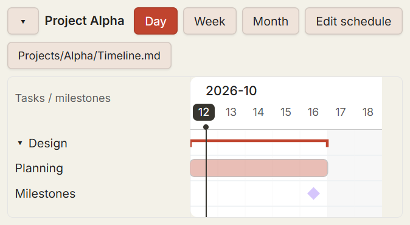

# Gantt charts (draft)

This first version adds tasks, milestones, groups, group/chart collapse and
day/week/month views. The source of truth is a top-level `apex-gantt` block in a
Markdown note. Dashboard cards reference the note and its stable `ganttId`.

## Try it

1. In a project note, run **Apex Dashboard: Insert chart in current note**.
2. Switch to reading view and select **Edit schedule**. Add groups, tasks and
   milestones, then save. Cancelling leaves the note unchanged.
3. With a dashboard open, use **Add to dashboard** on the chart, or run
   **Apex Dashboard: Reference a note chart in dashboard**. Select the note,
   chart (if there are several), and a Memo or Sticky section.
4. Edit either the source chart or its dashboard reference. Both use the same
   source block. Removing the dashboard card does not delete the note.

See [Project Alpha](../examples/gantt/Project-Alpha.md) and
[sample dashboard](../examples/gantt/Dashboard.md). These are entirely fictional.



```apex-gantt
{
  "note": "examples/gantt/Project-Alpha.md",
  "ganttId": "project-alpha"
}
```

Full vault-relative paths distinguish same-named notes in different projects.
Each source chart needs a unique ID *within its note*. Renaming a note while
Apex is enabled updates reference blocks; a missing/duplicate source produces
an error rather than silently attaching to another note. IDs must contain only
letters, digits, hyphens and underscores.

Milestones share one row per group. A folded group shows the member spans and
milestones together. Names are available in the left column and native SVG
tooltips for folded spans/milestones. Theme variables control chart colours.

## Validation and security

- No Gantt network calls, telemetry, external services or credential storage.
- Only vault-local `.md` source files: absolute paths, URL schemes, hidden
  segments, traversal and control characters are rejected.
- Names are rendered as text. The chart library receives generated row IDs and
  empty labels, not untrusted names/IDs for HTML templates.
- Writes replace a uniquely identified block and retain surrounding Markdown,
  CRLF line endings and unrelated chart blocks. Optimistic comparison rejects
  a stale editor instead of overwriting another update. No source files are
  created, moved or deleted by the feature.
- Maximum input: 100,000 string characters, 500 entries, 100 groups and a
  ten-year displayed span. Dates, identities and group membership are validated.
- The added dependency is Frappe Gantt 1.0.4 (MIT), pinned with lockfile integrity.
  Its [license](frappe-gantt-LICENSE.txt) covers the bundled JS and scoped CSS.
- At preparation time `npm audit --omit=dev` reports two **pre-existing moderate**
  findings for `moment`/`obsidian`. Adding Frappe Gantt does not increase that
  count; it introduces no audit finding. This does not certify the whole host
  plugin as vulnerability-free. Existing unrelated services remain unchanged.

## Checks and limitations

`npm run test:gantt` covers validation, references, CRLF preservation and stale
writes. `scripts/verify-gantt-runtime.mjs` additionally exercises a disposable
desktop Obsidian vault (see its guard); it refuses a normal vault. Runtime
metadata and screenshots under `node_modules/.tmp` are never committed.

This draft intentionally omits attachment linking, holiday datasets, aggregate
project schedules, custom section types and DOM interception. It uses existing
Memo/Sticky cards. UI strings are initially English; full localization and
mobile-device verification remain review items. It does not edit or replace an
existing production plugin installation.
